# Quant-Momentum

### A research diary: I set out to predict where prices go. They don't. So I learned to measure how far they swing.

Repository: [https://github.com/fahadnaseerhs/Quant-Momentum](https://github.com/fahadnaseerhs/Quant-Momentum)

> **The short version.** This project began as an attempt to forecast *mobility* — will this asset go up or down next month, and by how much. Six pre-registered attempts later, across 20 assets, 23 hindsight-free ETFs and 103,930 S&P 500 stock-months, the answer was the same every time: **direction is not forecastable from public price data, at least not by me, not at this breadth.**
>
> But the same data screamed something else. The **size** of the moves — the swings — is strongly, stubbornly, measurably predictable. A violent day is followed by violent days. A quiet month is followed by quiet months. That one asymmetry is the entire pivot of this project: from *"where is it going?"* (unanswerable) to *"how wide is the road, and how much should I put on it so a crash can't end me?"* (answerable, and testable the way banks test their own risk models).
>
> What follows is the story in order, the mathematics that made the pivot possible, and then — the long part — a region-by-region reading of every graph that mattered: not "the x-axis is time", but *what that cliff is, what that plateau means, what was happening in the world that week, and what the phenomenon is called.*

---

# Part I — The story

## 1. The question I started with

Every person who has ever opened a brokerage account asks the same thing, usually in the first week:

> **"Can I know whether this goes up or down, and how much?"**

That was the original project. Not vague "investing" — a concrete, falsifiable claim: *given everything knowable at the close of today, predict tomorrow's (or next month's) move.* I locked a universe of **20 tradeable assets plus the S&P 500 as a yardstick**, deliberately spread across six economic behaviours rather than six sectors:

| Segment | Assets |
|---|---|
| Crypto | BTC, ETH, SOL, LINK, AVAX |
| Big tech | AAPL, MSFT, NVDA, GOOGL, META |
| Gold | GLD, Barrick (B) |
| Oil & energy | USO, XOM, CVX |
| Real assets | VNQ, DBC, MSTR |
| Bonds | TLT (20+ yr), SHY (1–3 yr) |

Daily prices, cleaned onto one trading calendar, from 2021 for the core study and re-fetched back to **2 January 2004** for the long-history re-tests (5,729 trading days). Crypto simply does not exist for most of that span — Bitcoin's series starts in 2014, Solana in 2020 — and the code knows it: every number is computed only from the assets that actually traded that day.

Three rules were fixed before any model ran, and they are the reason the failures below are trustworthy:

1. **Walk-forward only.** Fit on the past, judge on days the model has never seen, refit monthly, forever forward.
2. **An embargo gap** between training and testing, because a 21-day forward return overlaps the next 20 days of training data. Without the gap you are grading your own exam.
3. **Pre-registration.** The pass bar is written down *before* the run. If the result misses the bar, it failed — you do not get to move the bar afterwards.

And one canary: deliberately feed the model *tomorrow's* feature to predict tomorrow's return. The information coefficient explodes from +0.0145 to **+0.1736**, a 12× jump. That proves the pipeline can detect cheating — and that the honest pipeline isn't cheating.

## 2. Six attempts, six failures

| # | What I tried | The question it asked | Data | Result | Why it failed |
|---|---|---|---|---|---|
| 1 | Linear regression, 15 features | rank 20 mixed assets by next-day return | 2021–26 | out-of-sample IC ≈ 0 (−0.003) | ranking Bitcoin against Treasuries is not a meaningful question; five asset classes, one ruler |
| 2 | Time-series momentum, ridge, 4 features | each asset against its *own* trend, 21 days | 2021–26 | IC −0.026, net Sharpe −0.10 | four years is too short to detect an edge this small |
| 3 | The same, on 21 years | same | 2004–26 | IC +0.052, net Sharpe 0.41 | looked real — until I noticed the universe was picked with hindsight (NVDA, Bitcoin, Solana) |
| 4 | The same, on 23 broad ETFs anyone could have bought in 2005 | same | 2004–26 | IC 0.008 (t = 0.7), Sharpe **0.11** | the edge evaporated the moment hindsight was removed |
| 5 | Prediction lab: macro trend, panic rebound, world regime, combined logistic, **boosted trees** | P(up next month) vs the base rate | both universes, 2005–26 | **all five worse than the base rate**; three worse than pure noise | ~5,000 independent monthly bets is not enough breadth for a tiny edge; flexible models memorise noise |
| 6 | S&P 500 stock ranking: 6 published signals + z-average + ridge + trees | which stocks beat the others next month | **103,930 stock-months**, 2005–26 | **none passed**; best was trees at t = 2.51 against a bar of 2.60 | and the near-miss was a *sector* bet — its within-sector IC was 0.0006 |

Read attempt 6 again, because it is the one that ended the argument. Nine candidates, a universe large enough to have real breadth, point-in-time index membership so no company joins the S&P 500 before it actually did — and the best candidate missed the pre-registered bar, *and* when you strip out "it was overweight technology during the decade technology won", the skill left over is **0.0006**. That is zero with extra steps.

**The lesson, as a formula.** Investing edge behaves roughly like

$$\text{edge} \;\approx\; \underbrace{\text{skill per bet}}_{\text{IC}} \times \sqrt{\underbrace{\text{number of independent bets}}_{\text{breadth}}}$$

Twenty assets, one decision a month, is a few hundred bets a year that are not even independent of each other — on the correlation evidence below they behave like **four**. Even genuine skill of 0.02 cannot clear the noise at that breadth. Markets are not unbeatable in principle; they were unbeatable *with the information I had and the number of bets I could place*.

## 3. The clue that was in the data the whole time

Buried in the exploratory work was a graph I had almost treated as housekeeping — the autocorrelation of returns against the autocorrelation of the *size* of returns:

- Ask *"does yesterday's direction predict today's direction?"* → the answer sits inside the noise band at every lag out to 20 days. Nothing. Coin flips.
- Ask *"does yesterday's **magnitude** predict today's magnitude?"* → the answer is **+0.125 at lag 1 and still +0.07 to +0.09 twenty days later**, far outside the noise band, on 18 of 21 assets.

The phenomenon has a name — **volatility clustering**, first written down by Mandelbrot in 1963 — and the weather analogy is exact: nobody can tell you whether tomorrow will be warmer or colder than today, but everybody knows that if there is a storm today, tomorrow is more likely to be stormy than calm.

**Why does one survive and the other doesn't?** Because a predictable *direction* is free money, and free money gets arbitraged away the instant it is noticed — you simply buy it until the price moves and the edge is gone. A predictable *swing* is not free money. You cannot "buy volatility" without taking on real risk, and the mechanisms that create it are physical rather than informational:

- **Information arrives in bunches.** A central bank meeting, an earnings season, an invasion — these are not spread evenly across the calendar.
- **Leverage and margin calls.** Falling prices trigger margin calls, which force selling, which moves prices further, which triggers more margin calls. Volatility literally manufactures volatility.
- **Mechanical sellers.** Risk-parity funds, vol-control funds and option dealers hedging gamma are all *required* to sell when volatility rises. Their rulebooks make the cluster persist.

So the question changed:

> **Old:** "Will this asset go up or down, and by how much?" — unanswerable.
> **New:** "How wide is this asset's road right now, what does its 1-in-20 bad month look like, and how much of my money can sit on it so that no single crash can end me?" — answerable, and checkable against history.

## 4. The mathematics of the pivot

Seven pieces of maths carry the whole system. None of them forecast a direction.

**(a) The swing estimate — EWMA volatility.** Yesterday matters most, last month matters a little, last year barely:

$$\sigma_t^2 = \lambda\,\sigma_{t-1}^2 + (1-\lambda)\,r_{t-1}^2,\qquad \lambda = 0.94$$

A shock's influence halves every $\ln(0.5)/\ln(0.94) \approx \mathbf{11.2}$ trading days. The monthly swing is $\sigma_t\sqrt{21}$ — the square-root-of-time rule. A smarter forecaster (**HAR**, which blends yesterday's, last week's and last month's realised volatility) beat EWMA out-of-sample on 16 of 20 assets, −8.7% forecast error, Diebold–Mariano t = 2.76 — the project's **only** statistically significant out-of-sample prediction. It barely changed the portfolio, and EWMA reacts faster in a crash, so EWMA stayed as the sizing input. Honest result, modest consequence.

**(b) The outcome range — empirical, never Gaussian.** Standardise each month's move by the risk known *before* it, $z = R_{t\to t+21} / (\sigma_t\sqrt{21})$, and read the **5th, 16.7th, 50th, 83.3rd and 95th percentiles of the asset's own history** of those z-values. No bell curve is assumed, because the bell curve is wrong in exactly the place that matters — the tail. The distribution is centred on its *median*, so an asset's past rise is not sold back to the user as a future rise, and then the *whole universe's* typical drift is added back as one common number, so Bitcoin is not credited with Bitcoin's own history.

**(c) How many bets you really own.**

$$N_{\text{eff}} = \frac{N}{1+(N-1)\bar{\rho}} = \frac{20}{1 + 19 \times 0.21} \approx \mathbf{3.9}$$

Twenty tickers. Four opinions.

**(d) Position sizing — equal risk, not equal money.** Naively, $w_i \propto 1/\sigma_i$. Properly, solve for the weights whose *risk contributions* are equal once correlations are counted:

$$w_i\,(\Sigma w)_i \;\propto\; b_i$$

iterated to convergence ($w \leftarrow w\sqrt{b/\mathrm{RC}}$). This runs twice: once inside each segment, once across segments. An asset that swings ±30% a month gets 2–5% of the money; one that swings ±2.5% gets 20–30%. Every dollar then carries the same weight of worry.

**(e) The loss cap — the part that decides when to sell.** Each profile names the worst month it is willing to accept, and the invested share is scaled so the plan's own empirical 1-in-20 month stays inside it: **CAREFUL −3%, BALANCED −6%, BOLD −10%.** In calm markets the cap doesn't bind and the plan is fully invested. When volatility rises, the cap binds and money moves to the short-term Treasury sleeve *automatically*. Nobody forecasts the crash; the arithmetic simply refuses to carry that much risk at those prices. The always-invested version of the same book lost about 50% in 2008 — which is precisely why the cap exists.

**(f) Trading as little as possible.** Check weekly; trade an asset only when it has drifted more than **20%** away from its target and the trade is worth at least **$5**; charge 10 bps on every trade actually made. Rebalancing daily on a signal that changes over 21 days is paying a toll to chase noise: at 20 bps the daily-traded version's Sharpe collapsed from 0.56 to **0.07**, while the weekly version held at 0.37–0.49.

**(g) The tests that decide whether any of it is honest.** Newey–West standard errors (because stormy days cluster, so naive error bars lie), the **Kupiec** test (is the 1-in-20 warning breached about 1 time in 20?), the **Christoffersen** test (do breaches clump into one panic, or arrive independently?), and a design/holdout split at 2016 — every parameter chosen on 2005–2015, then frozen and judged on 2016–2026.

## 5. What the project became

A risk-first allocation framework, and a live terminal that runs it: it reports how wide each asset's road is today, how much of your money that justifies, what a 1-in-20 bad month costs, and when to trim — and it refuses to display any number that has not passed a formal backtest of its own honesty. Of the five risk numbers tested, three passed (per-asset bad case, typical range, the plan's bad month) and two failed (the upside case and expected shortfall). **The two that failed are not on the screen.** That rule is the product.

---

# Part II — Reading the graphs

Every graph below is read the way you would read a map of a journey: *which stretch of the line is which year, what was happening in the world during that stretch, why the line did that, and what the thing that just happened is called.* The axes get one line, because the axes are the least interesting thing about a graph.

The research graphs come from two different windows, and it matters:

- **2021 → 2026** figures (the exploratory and signal work) cover the crypto bull run, the 2022 bear market, the FTX collapse, the April 2025 tariff shock and the January 2026 gold dislocation.
- **2004/2005 → 2026** figures (the allocation and robustness work) cover the Global Financial Crisis, the Covid crash and the 2022 inflation shock.

---

## Act I — Five pictures of a hypothesis dying

### 1. The scatter plot where the dream died

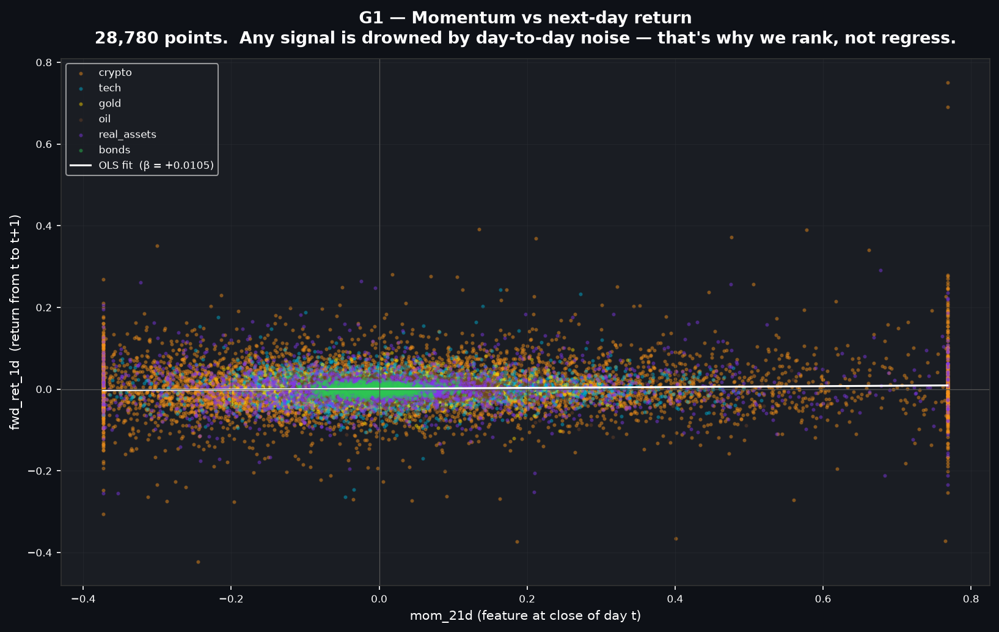

*Each of the 28,780 dots is one asset on one day: horizontally its 21-day momentum at tonight's close, vertically what it actually did the next day; the white line is the best straight-line fit through all of them.*

This is the single most honest picture in the project, and it is the first one I should have drawn.

- **The centre, x between −0.1 and +0.2 — the fog bank.** Almost all the mass lives here, a dense horizontal cloud about ±5% tall. These are ordinary assets on ordinary days. Whatever today's momentum is, tomorrow lands anywhere in a band ten times wider than the thing you are trying to predict.
- **The left shoulder, x from −0.37 to −0.1 — assets that have been falling for a month.** If reversal were a real force, this region would tilt *upwards*: beaten-down names bouncing. It doesn't tilt. The spread just gets taller, because falling assets are volatile assets — which is a statement about **size**, not direction. That is the first hint of the whole pivot, visible here as a widening cone rather than a slope.
- **The right shoulder, x from +0.3 to +0.77 — the hot streaks.** Assets up 30–77% in a month, overwhelmingly crypto (orange). Still no tilt. The biggest single-day gains in the entire sample (+0.75, +0.69) sit here — and so do −0.38 days, in the same column.
- **The two vertical walls at x ≈ −0.37 and x ≈ +0.77.** Not real data. Those are **winsorisation caps**: extreme feature values clipped to the 1st and 99th percentile so that one Solana month cannot hijack an average. Knowing which marks on a chart are the market and which are your own code is half of quantitative research.
- **The white line.** Slope **+0.0105**. In words: ten percentage points more momentum today buys you one-tenth of a percentage point more return tomorrow — against daily swings of ±5% to ±20%. The signal is roughly 1% of the noise.

**The phenomenon.** This is what an **efficient market** looks like from the inside — not a conspiracy, just a price that has already absorbed the public fact "this thing went up last month." It is also why the project switched to **rank correlation (the information coefficient)** instead of regression: when the noise is 100× the signal, you stop asking "how much" and start asking "did I at least get the *order* roughly right?"

**In the real world.** Every chart pattern sold on the internet lives inside that fog bank. The pattern is real in the sense that it is visible; it is useless in the sense that the next day's dot lands anywhere in the cloud regardless.

---

### 2. The odometer: a real but pitifully thin edge, and its year-long droughts

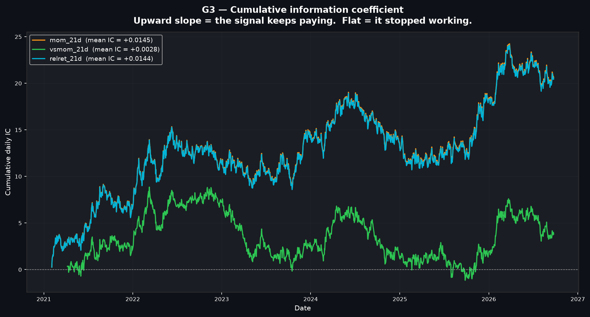

*Running total of the daily ranking score from 2021 to late 2026 — rising means the signal is paying, flat means it has stopped, falling means it is working backwards; the slope at any point is the average skill at that moment.*

The blue/orange line is 21-day momentum (the two are mathematically identical — subtracting the S&P's return from everybody changes nobody's rank). The green line is momentum divided by the asset's own risk.

- **Early 2021 → August 2021: 0 → ~9 for the risk-scaled version, 0 → ~5 for plain momentum.** The post-stimulus everything-rally. Dispersion between assets was enormous — crypto tripling while bonds sat still — and when dispersion is large, *any* ranking looks skilled, because the gaps between assets are bigger than the noise within them.
- **August 2021 → January 2022: a flat, choppy plateau.** The rally narrowed. The signal stopped paying and simply oscillated — your first lesson that "it worked last quarter" is not information.
- **January 2022 → June 2022: the steepest climb on the chart, ~6 → ~15.** This is momentum's best possible weather: the Fed began the fastest hiking cycle in forty years, Russia invaded Ukraine on 24 February, and the market sorted itself into a clean, persistent ordering — energy and commodities up, long bonds and growth tech and crypto down, *and it stayed that way for months*. A ranking signal does not need to predict the future here; it only needs the present ordering to persist a little longer, and in a one-directional macro regime it does.
- **June 2022 → October 2023: the long bleed, 15 → ~8.8.** Sixteen months of giving back. This stretch contains the FTX collapse (November 2022), the October 2022 bottom and the violent off-the-lows rally, and the March 2023 regional-banking scare. Each of those is a **sharp reversal**, and reversals are poison to a momentum ranking: you are, by construction, maximally long whatever just ran and maximally short whatever just collapsed, exactly when the two swap places. The textbook name is a **momentum crash**, and the loss here — about six units, a full year and a half of progress — is what it feels like without leverage.
- **October 2023 → July 2024: recovery to ~19.** The AI rally. One persistent theme, strong trends, momentum works again.
- **July 2024 → mid-2025: down to ~11.** Rotation, then the April 2025 tariff shock. A V-shaped crash-and-rebound is the single worst environment for this signal.
- **December 2025 → March 2026: a near-vertical surge, ~12 → ~24.** The steepest segment in six years. Note the shape: a *step*, not a slope. When a cumulative-IC chart gains a third of its lifetime total in three months, the honest reading is "one regime paid for everything", not "the signal got better".
- **March → September 2026: fades to ~20.5.**

**The arithmetic underneath.** 20.5 units over ~1,400 days is a mean IC of **+0.0145** — and the daily values swing between −0.9 and +0.9 to produce it. The Newey–West t-statistic is 1.57. In a world where 2.0 is the conventional "probably not luck" line and 182 tests were run, **1.57 is a candidate, not a discovery.**

**In the real world.** This is the graph that explains why professional quant funds die. The strategy was *right* on average over six years and still spent **two separate stretches of roughly a year going backwards.** No retail investor, and very few institutional allocators, survive a year of being wrong on purpose.

---

### 3. The overfitting graph: certain in training, worthless in reality

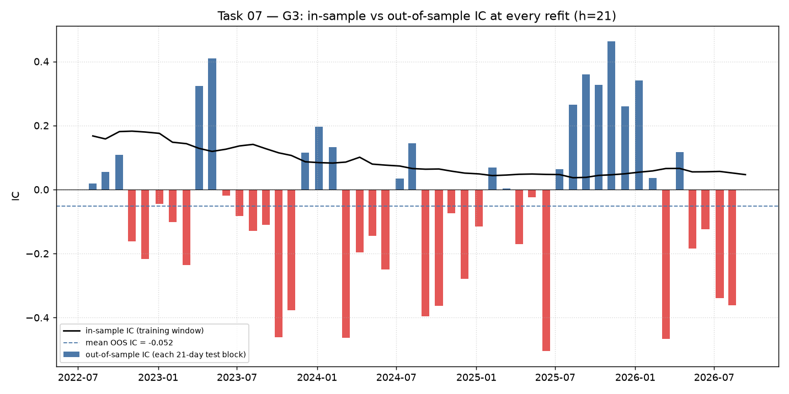

*The black line is how well the model fitted the data it was trained on at each monthly refit; each bar is how well that same model then predicted the next 21 days it had never seen — blue above zero is right, red below is wrong.*

This is the picture I would put on the wall of any machine-learning course.

- **The black line, across the entire chart.** It starts at **+0.17** in mid-2022 and decays gently to **+0.05** by 2026, and it is **never once negative**. For four and a half years, at every single monthly refit, the model looked at its own training data and concluded that trend-following works. The confidence is unbroken.
- **The bars, same chart, same model, the very next month.** They average **−0.052**. More red than blue. The model's forward-looking opinion is not merely weak — it is *slightly inverted*.
- **July 2022 → January 2023 — the first run of reds (−0.16, −0.21, −0.10, −0.24).** The 2022 bear market's late stage, where trends reversed repeatedly on inflation prints and Fed meetings.
- **February → May 2023 — the two tall blues (+0.32, +0.41).** The model's best stretch; this is the recovery off the October 2022 low. If you were running this live, this is where you would have concluded it was working.
- **August 2023 → mid-2024 — the deepest reds on the chart (−0.46, −0.50, −0.46).** Immediately after that success. The whipsaw.
- **July 2025 → January 2026 — a six-bar run of blues (+0.26, +0.36, +0.33, +0.46, +0.26, +0.34).** The most convincing stretch in the sample, and the exact period in which somebody would have raised money on this model.
- **February 2026 — a −0.46 bar, immediately after.** And then another −0.36 in July 2026.

**The phenomenon has two names.** The gap between the black line and the bars is **overfitting** — and note that this model has only **four features**. Overfitting is not a disease of big neural networks; it is what happens whenever you fit a pattern to a sample that was generated mostly by noise. The clumping of blues and reds into multi-month runs is **regime dependence**: the model is not skilled or unskilled, it is in sync or out of sync with whatever the market is currently doing, and nothing tells you which in advance.

**In the real world.** Every backtest you are ever shown is the black line. The bars are what you actually get. The industry phrase for the distance between them is *"sell the backtest, live the out-of-sample"*, and this chart is the measurement of that distance for an honest, 4-feature, embargoed, walk-forward model: **about 0.14 of information coefficient, all of it imaginary.**

---

### 4. Five models, one pre-registered test, zero survivors

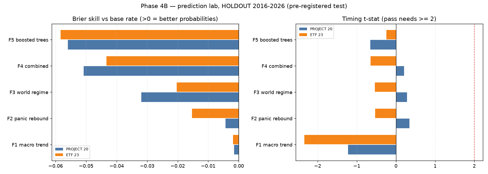

*Left: how much better each model's probabilities were than simply quoting the historical base rate — anything left of zero is worse than knowing nothing. Right: the t-statistic of its market-timing value, which had to reach the red line at +2 to pass; blue is the 20-asset universe, orange the 23 hindsight-free ETFs.*

Five families were written down, with their pass bars, *before* the data was touched: a macro-trend model, a panic-rebound model ("buy after capitulation"), a world-regime model (VIX, yield curve, credit spreads, inflation breakevens), a logistic model combining all of them, and gradient-boosted trees.

- **Every single bar in the left panel is on the wrong side of zero.** Not one of the five beat "assume this month looks like the average month."
- **The bottom of the panel — F1 macro trend, −0.002 and −0.001.** The simplest model is the *least* bad. It barely moves away from the base rate, so it barely loses.
- **Climbing the panel — F2 panic rebound (−0.004 / −0.015), F3 world regime (−0.032 / −0.020), F4 combined (−0.051 / −0.043).**
- **The top — F5 boosted trees, −0.056 and −0.058, the worst of the five in both universes.** The most powerful model, given the most freedom, finished last. Twice.

That monotonic ordering — the more flexible the model, the worse the out-of-sample score — is the **bias–variance trade-off** drawn from life. With roughly 5,000 asset-months and no real signal to find, extra flexibility can only be spent on memorising noise. This single panel answered the question "should I try XGBoost next?" more decisively than running XGBoost would have.

- **The right panel.** Not one bar reaches the +2 pass line; most are negative. The one bar that *is* statistically distinguishable from zero is **F1 macro trend on the ETF universe at −2.34** — significantly *wrong*. And no, you cannot simply flip the sign and collect the money: that reasoning is the definition of **data-dredging**, and a reliably invertible signal would be arbitraged out as fast as a correct one.

**In the real world.** This panel is what "I'll just throw machine learning at the market" looks like when it is tested fairly rather than demonstrated. The controls in the same run (shuffled inputs, pure noise inputs) behaved exactly as they should, which means the pipeline was fair and the models genuinely had nothing.

---

### 5. The last stand: 103,930 stock-months, and the near-miss that wasn't

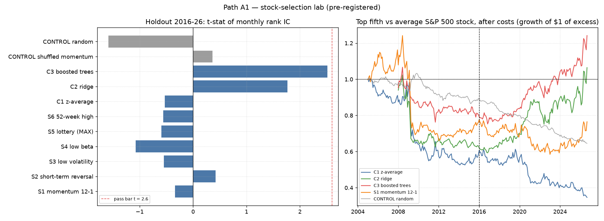

*Left: the strength of evidence for each stock-ranking signal over the 2016–26 holdout, with the pre-registered pass bar at t = 2.6 in red. Right: growth of $1 of pure outperformance — top fifth of stocks minus the average stock, after costs — from 2005 to 2026, with the dashed line marking where the holdout begins.*

If breadth was the problem, the S&P 500 was the cure: 642 companies, point-in-time membership so nothing joins the index before it really did, 103,930 stock-months. Six published academic signals, three combinations, two controls.

**The left panel, top to bottom:**

- **C3 boosted trees, t ≈ 2.51** — close enough to the 2.6 bar to hurt. Held to the pre-registered rule, it fails. Investigated anyway: its information coefficient *within sectors* is **0.0006**. The model had not learned to pick companies; it had learned to be overweight technology during the decade technology won. That is a sector bet wearing a lab coat.
- **C2 ridge, t ≈ 1.75**; **C1 z-average, S1 momentum 12-1, S3 low volatility, S4 low beta, S5 lottery, S6 52-week high — all between −1.1 and +0.4.** These are not obscure ideas. They are the signals that built the factor-investing industry, and across 2016–26 large-cap US equities they are worth nothing after costs.
- **The two grey controls** behave as controls should: shuffled momentum at +0.35, random at −1.6 — noise, both sides of zero.

**The right panel, left to right, is the better story:**

- **2005 → mid-2008 — the orange momentum line climbs to ~1.15.** Classic momentum, working as advertised through the pre-crisis bull.
- **September 2008 → March 2009 — the cliff. Every line falls off a ledge simultaneously**, orange from 1.1 to 0.7, blue to 0.6, green to 0.62. This is the most famous single event in factor investing: the **2009 momentum crash**. After Lehman, a momentum portfolio was by construction long defensives and short the most beaten-down financials and cyclicals. When the market bottomed in March 2009, the garbage rallied hardest — some of those names tripled off the low — and the strategy that had been short them was annihilated in weeks. This is the single most important thing on the chart: *momentum's failure is not gradual, it is a cliff, and it arrives exactly at the turn.*
- **2009 → 2016 — the long grind sideways-to-down.** Blue (the composite) decays from 0.62 to 0.55; orange recovers weakly; the grey control sinks from 1.0 to 0.85. The control is the tell: a *random* selection should earn the average, and it doesn't — it loses steadily, because it pays transaction costs and the average doesn't. That downward grey drift is pure **cost drag**, and it is the cost every active strategy pays before it earns anything.
- **2016 → 2026, right of the dashed line — the holdout.** Red (boosted trees) climbs from 0.78 to **1.24**, green (ridge) from 0.6 to 1.06; blue decays to **0.35**; orange momentum never recovers; the grey control bleeds on to 0.64. Red looks like a winner, and it is — of a sector allocation, not of stock selection.

**In the real world.** Published price-based signals in large-cap US equities are **crowded**: once a hundred thousand people read the same paper and trade the same rule, the rule stops being an edge and becomes a cost. The way forward is not a better model on the same prices; it is *different information* — fundamentals, filings, text — or a different question altogether. I chose a different question.

---

## Act II — Six pictures of the thing that *is* predictable

### 6. The pivot graph: direction is noise, size is memory

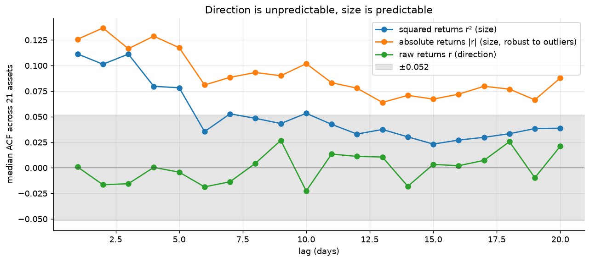

*How much today resembles the day before it, one to twenty days back, averaged across all 21 assets — green asks it about direction, orange and blue about the size of the move, and the grey band is the width of pure luck (±0.052).*

Three lines, one conclusion, and the whole project turns on it.

- **The green line, every lag from 1 to 20.** It wanders between −0.023 and +0.027 and **never once leaves the grey band**. Yesterday's direction tells you nothing about today's; the day before that tells you nothing; a fortnight ago tells you nothing. In the full per-asset version of this test, 210 hypotheses were examined and about 9 poked outside the band — luck alone predicts about 10. There is no residue of signal here at all.
- **The orange line at lags 1 to 5: +0.125, +0.137, +0.116, +0.128, +0.117.** Two and a half times the noise band, immediately. If today's move was big, tomorrow's is likely to be big — in *either* direction.
- **Lags 6 to 12: orange settles at 0.08 to 0.10.** Two weeks later, the memory of a shock is still clearly measurable.
- **Lags 13 to 20: orange is still 0.064 to 0.088 — still outside the band at every single lag.** A month after a storm, the air has not finished clearing. This slow, non-exponential fade has a name: **long memory** in volatility. It is why the terminal's risk estimate uses a fading memory rather than a fixed window, and why a single "the volatility of asset X is 23%" number is a lie about every asset.
- **The blue line — the same question asked with squared returns.** It starts at 0.11, keeps pace with orange for five lags, then **dives into the noise band from lag 6 onward**. This is not a different market, it is a different ruler: squaring the returns lets one catastrophic day dominate the whole calculation, so the estimate itself becomes noisy. Measured with absolute returns, 18 of 21 assets show clear clustering; measured with squares, only 8 do. **The tool you measure with can hide the thing you are measuring.**

**The name.** **Volatility clustering**, the single most robust empirical regularity in finance — documented in cotton prices in 1963, present in every market since, and the reason the ARCH/GARCH family of models exists at all (and won a Nobel Prize in 2003).

**Why the universe allows it.** Direction cannot persist, because persistence is money and money gets taken. Size persists because it is mechanical: margin calls force selling, which creates more volatility, which triggers more margin calls; vol-targeting and risk-parity funds are *contractually obliged* to cut positions when volatility rises; options dealers hedging a short gamma book must sell into falls and buy into rallies. None of that can be arbitraged away, because none of it is a free bet — it is just how the plumbing behaves under pressure.

**So the entire project turned ninety degrees here.** You cannot know where the road goes. You can know, with real statistical confidence, how wide it is — and knowing the width tells you how fast to drive.

---

### 7. How to measure a swing, and the fake cliff that fooled me first

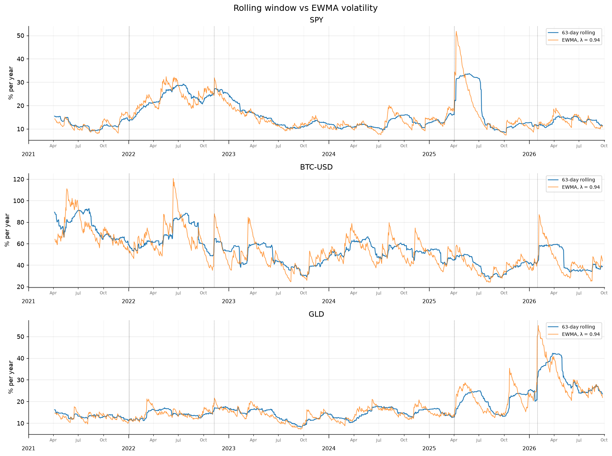

*Annualised swing size, 2021 to 2026, for the S&P 500, Bitcoin and gold: blue averages the last 63 days equally, orange is a fading memory that weights yesterday most (λ = 0.94); the dotted verticals are the 2022 bear market, the FTX collapse, the April 2025 tariff shock and the January 2026 gold dislocation.*

Read the **top panel (SPY)** left to right as a history of the last five years of American markets.

- **April → December 2021: a flat 10–15% band.** Post-stimulus calm. Both measures agree, because nothing is happening — in calm weather every thermometer reads the same.
- **January → June 2022: the climb, 14% → 32%.** The Fed begins the fastest hiking cycle in four decades; Russia invades Ukraine on 24 February; oil and European gas spike; the S&P enters a bear market. Notice the *shape*: not a jump but a staircase, each step a new macro print. This is a **volatility regime shift**, and it is the thing the portfolio needs to react to.
- **June → November 2022: a high plateau, 25–32%, with a spike at the FTX line.** The entire year is lived at double the normal swing width. In the allocation framework this is exactly when position sizes shrink and money drifts into the short-term Treasury sleeve — not because anyone predicted FTX, but because the road visibly narrowed.
- **December 2022 → July 2023: the long descent, 27% → 10%.** Inflation rolls over, the market stops panicking at every print. Volatility **mean-reverts** — unlike prices, which have no gravity, volatility always comes home.
- **Mid-2023 → mid-2024: the calm, 10–14%.** One of the quietest stretches in the sample. Calm begets calm; this is the same clustering seen from the other side.
- **Around August 2024: a sharp bump to ~20%, decaying within weeks.** A short, violent scare rather than a regime change — it arrives fast and leaves fast, and that *shape* is itself diagnostic: a leverage unwind looks nothing like the staircase of early 2022.
- **April 2025 — the tariff shock, the most instructive few weeks on the chart.** The orange line goes **vertical: from ~16% to ~52% in a handful of sessions.** The blue line jumps too, but only to ~33%. The gap between those two numbers is the gap between a risk system that noticed and one that is still averaging in last quarter's calm.
- **April → June 2025: orange decays smoothly from 52% back toward 15%**, halving roughly every 11 trading days, while **blue sits on a flat plateau at ~33% for nearly three months.**
- **Early July 2025 — the cliff.** The blue line falls vertically from ~33% to ~11% **in a single step.** Nothing whatever happened in the market that day. The April shock simply reached its 64th day and dropped out of the 63-day window. This artefact is called a **ghost feature** (or window drop-out), and it is the most common silent bug in homemade risk code: your model declares the crisis over, on a schedule, three months after the fact. The same cliff appears in the gold panel in spring 2026 and in the correlation chart in graph 11.
- **The Bitcoin panel, 2021 → 2026: 90–120% falling to a 25–60% range.** Crypto's swing width has roughly halved as the asset institutionalised. Risk is not a fixed property of an asset — it is a property of an asset *at a time*, which is why a framework that re-measures every day beats one that looks up a number in a table.
- **The gold panel, January 2026.** Orange leaps to ~55%, blue grinds up to ~42% weeks later, then drops off its own cliff in the spring. The asset everybody files under "safe" printed the highest volatility in its five-year history here; safety is a behaviour, not a label.

**In the real world.** This chart is the difference between a car whose suspension reacts to the road and one that reacts to the road it drove last quarter. Both cars have a suspension. Only one of them is useful in April 2025.

---

### 8. The one prediction that worked — and the one it still can't make

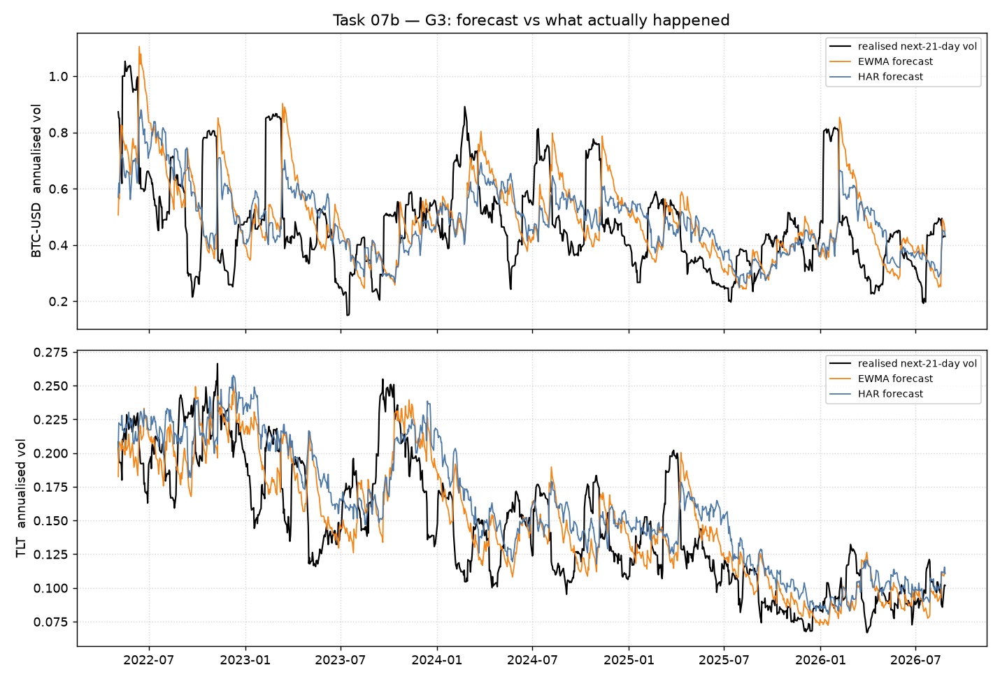

*Black is the swing size that actually happened over the following 21 days; orange and blue are two forecasts of it, both made before the fact, for Bitcoin (top) and 20-year Treasuries (bottom), 2022–2026.*

After everything that failed, here is the thing that worked. Both forecasts genuinely track the truth.

- **The TLT panel, mid-2022 → January 2023: realised volatility climbs to its peak near 0.265.** This is the bond market having the worst year in its modern history — 425 basis points of hikes in twelve months, the UK gilt crisis and the forced LDI deleveraging in late September, and a −31% drawdown in an asset class most people hold *as their safety*. Both forecasts follow it up.
- **2023 → mid-2026: the long glide, 0.265 → 0.075.** A three-and-a-half-year normalisation of interest-rate volatility, and both forecast lines ride it down the whole way. **The *level* of risk is genuinely forecastable** — that is the finding.
- **Look at every spike, in either panel.** The **black line always moves first**; the forecasts arrive a week or two later. Nobody saw the shock; everybody could see, immediately afterwards, that the world had become more dangerous.
- **After each spike, orange overshoots.** EWMA, having over-reacted on the way up, stays too high on the way down. Blue (HAR, which blends yesterday's, last week's and last month's realised volatility) is visibly smoother and overshoots less. That is the whole of HAR's measured advantage: −8.7% forecast error, better on 16 of 20 assets, Diebold–Mariano t = **2.76** — the project's only statistically significant out-of-sample prediction.
- **The Bitcoin panel, same story at four times the amplitude**: realised volatility between 0.15 and 1.05, forecasts tracking the band and the trend, missing every jump.

**The phenomenon.** Volatility is **persistent and mean-reverting** — two properties prices do not have. That is precisely why it can be forecast. **Jumps**, on the other hand, are unforecastable from price history alone, which is a formal way of saying: *you cannot know when the shock arrives, only that you are living in a dangerous period once it has.*

**In the real world.** This is the entire business model of risk management, and of the options market: nobody sells you insurance by predicting your crash, they price it off how turbulent the neighbourhood currently is. It is also why the terminal sizes *down* within days of a shock and sizes *back up* as the shock fades, with no view whatsoever about what prices will do next.

---

### 9. Fat tails: the bell curve is wrong exactly where being wrong is fatal

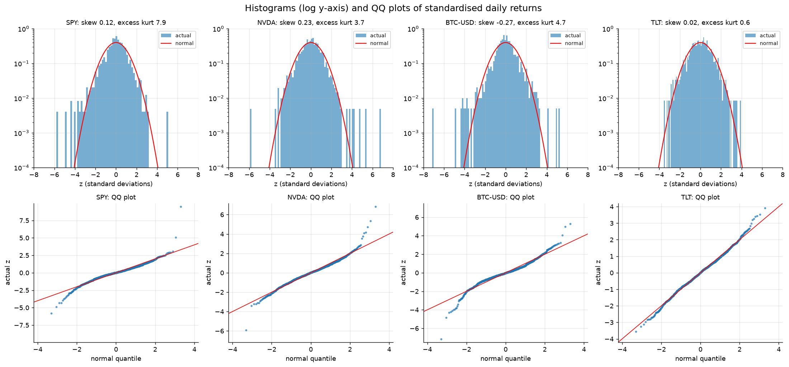

*Top row: how often each size of daily move actually occurred (bars) against what a bell curve says should occur (red), on a log scale so the rare events are visible; bottom row: the same comparison as a straight-line test — dots on the red line mean "normal", dots peeling off the ends mean fat tails.*

- **The middle of every histogram, between −2 and +2 standard deviations.** The bars hug the red curve. For ordinary days, the textbook is fine, which is exactly why the textbook survived so long.
- **Beyond ±3 standard deviations — where the bars escape the curve.** On SPY, NVDA and Bitcoin there are isolated bars sitting far outside a red line that has already fallen to nearly zero. These are days the normal distribution says should not exist.
- **The single dot at +9.3 on the SPY QQ plot.** One day in the sample, the S&P moved more than nine standard deviations — the April 2025 rebound, when a tariff pause triggered one of the largest single-day gains in the index's history. Under a bell curve, a 9σ day has a probability so small that you would not expect one in the lifetime of the universe, let alone in a five-year sample of one index. It is on the chart. Its mirror image, a −6σ day, is on the chart too.
- **Bitcoin's left tail: a −7.1σ day**, and the QQ dots peel away from the line on *both* ends. Excess kurtosis 4.7.
- **SPY's excess kurtosis: 7.9.** For reference, a true bell curve scores 0. Every one of the 21 assets scores positive, from 0.6 up to 23.5.
- **The TLT panel — the control.** Short-term rates behave themselves: kurtosis 0.6, dots hugging the line almost perfectly. Fat tails are not a law of nature; they are what happens to *risky, levered, liquidity-dependent* assets.
- **The S-shape in the bottom row** is the signature itself: the lowest dots sit **below** the line (crashes deeper than theory) and the highest sit **above** it (rebounds sharper than theory).

**The name is leptokurtosis** — the polite word for "the tails are fat and the middle is peaked". The causes are structural, not statistical: liquidity vanishes exactly when everyone needs it, forced deleveraging turns a fall into a cascade, prices gap overnight instead of sliding continuously, and the people quoting the market step away from their screens.

**Why it matters more than anything else on this page.** Every classical risk formula — Value-at-Risk off a normal distribution, the Black–Scholes assumption, the "my portfolio is 12% volatile so I'm fine" reflex — assumes the red line. When a bank's risk officer famously described seeing multi-standard-deviation moves on consecutive days in 2007, he was not describing an impossible market; he was describing a wrong model. **That is why this project never assumes a distribution.** The bad-case number the terminal shows is read directly off the asset's own realised history of extremes, fat tails included.

---

### 10. Twenty tickers, four opinions

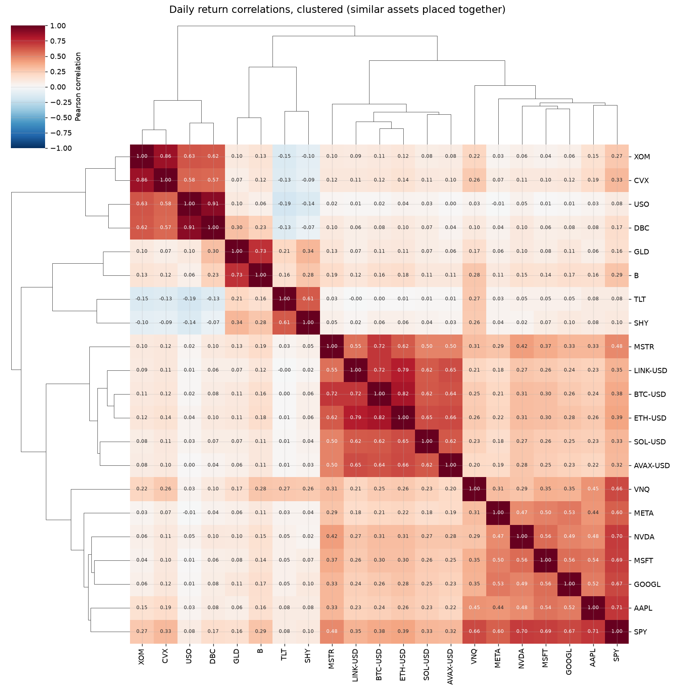

*Every asset against every other asset, with daily co-movement in each cell — deep red means they move together, white means unrelated, blue means they move opposite — and the trees on the edges reorder the grid so that things which behave alike sit together.*

Read the **red squares along the diagonal**: each one is a group of assets that is, functionally, a single bet.

- **Top-left — the oil block.** XOM–CVX **0.86**, USO–DBC **0.91**. Two oil majors, a crude fund and a broad commodity index are, statistically, one position. Owning all four is owning one thing four times.
- **The gold block.** GLD–B **0.73**. Bullion and the miner that digs it up, as expected — but notice the miner is an *equity* and still trades with the metal.
- **The bond block.** TLT–SHY **0.61**. Same driver (interest rates), different sensitivity.
- **The crypto block, with a stowaway.** BTC–ETH **0.82**, ETH–LINK **0.79**, SOL–AVAX **0.62** — and **MSTR–BTC 0.72**. MicroStrategy is legally a US-listed software company. Behaviourally it is a leveraged Bitcoin proxy, and the clustering algorithm — which has never read a prospectus — files it with the coins. **Labels lie; behaviour doesn't.**
- **Bottom-right — the US equity block.** SPY–AAPL **0.71**, SPY–NVDA **0.70**, SPY–MSFT 0.69, SPY–GOOGL 0.67, and SPY–VNQ **0.66** (real estate is an equity sector wearing a different hat).
- **The pale blue corner, top-left against the bond rows — the most valuable region on the chart.** TLT–USO **−0.19**, TLT–XOM −0.15, SHY–USO −0.14. The only reliably *negative* relationship in twenty assets is **long bonds against oil**. That is not a coincidence or a quirk of the sample: it is the inflation axis. Bonds are a bet that the future is deflationary; oil is a bet that it is inflationary. They are supposed to disagree, and in 2022 that disagreement was the only thing between a diversified portfolio and a disaster.
- **Everywhere else — the pale pink wash of 0.02 to 0.35.** Most pairs are mildly positively correlated. Not zero. That matters:

$$\bar\rho = 0.21 \quad\Longrightarrow\quad N_{\text{eff}} = \frac{20}{1+19(0.21)} \approx 3.9$$

**In the real world.** This is the graph that explains why a portfolio of "twenty different stocks" is not diversified. Diversification is not counting tickers; it is counting *independent economic stories*. Twenty names here buy you about four: growth equity, inflation/real assets, rates, and crypto. If you own ten tech stocks and an S&P fund, your effective number of bets is close to **one**.

---

### 11. The cruelty of correlation: diversification fails precisely when you need it

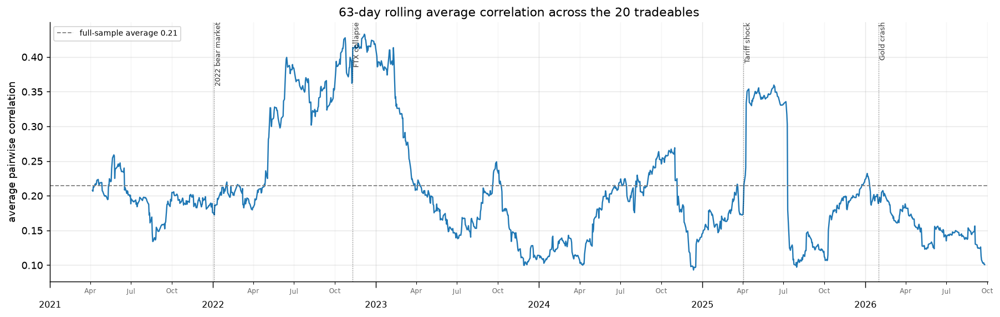

*Average co-movement across all twenty assets, recomputed every day over the trailing quarter, 2021–2026; the dashed line is the five-year average of 0.21.*

The previous graph gave one number for five years. This one shows that the number is a fiction — the thing moves, and it moves against you.

- **2021: hovering at the 0.21 average, dipping to 0.135 in mid-year.** A calm, dispersed market. Assets doing their own thing, diversification working as advertised.
- **January → June 2022: the climb, 0.20 → 0.40.** As the Fed hiking cycle began and Russia invaded Ukraine, everything in the portfolio stopped being an individual asset and became an expression of one question: *what will rates do?* Your twenty bets quietly became one bet.
- **November–December 2022, at the FTX line: the peak, 0.43.** Double the normal level. In the middle of a leverage unwind, a crypto exchange's collapse was transmitted into assets with no connection to it, because the people forced to sell owned everything.
- **February 2023: a near-vertical drop from ~0.40 to ~0.22.** Part real calming, part the same **ghost-window artefact** from graph 7 — the 63-day window forgetting the panic on a schedule. Knowing which half is which is the difference between a market observation and a plotting artefact.
- **Mid-2023 → late 2023: the trough, down to 0.10.** The calmest, most dispersed stretch in the sample. Stock-picking weather. Also, note: *this* is when a backtest of a diversified portfolio looks magnificent.
- **October 2024: a climb to 0.27, then a slide to 0.095 by December.**
- **April 2025, the tariff shock: a step up to ~0.35, held as a plateau into July, then another cliff to 0.10.** The step is real (a single policy shock repriced every asset at once); the cliff is the window again.
- **2026: back around 0.20, drifting down to 0.10 at the right edge.**

**The name.** **Correlation breakdown**, or more bluntly *"in a crisis, all correlations go to one."* The mechanism is **funding liquidity**: when a levered investor receives a margin call, they do not sell what they would like to sell, they sell what they *can* — which is the liquid, healthy, uncorrelated thing in the corner of the portfolio. That is why gold fell in March 2020 alongside everything else, and why your carefully chosen diversifier becomes a source of losses in precisely the week you were counting on it.

**What the project does about it.** Nothing clever, and that is the point: correlations are recomputed on a rolling window and fed straight into the risk-contribution solver, so when the market converges on one bet, the *measured* risk of the book rises, the bad-month cap binds, and the invested share shrinks on its own. The framework does not predict the convergence. It just refuses to pretend it isn't happening.

---

## Act III — Three pictures of what the project became

### 12. Twenty-one years of the allocation rule, including the two worst months of modern finance

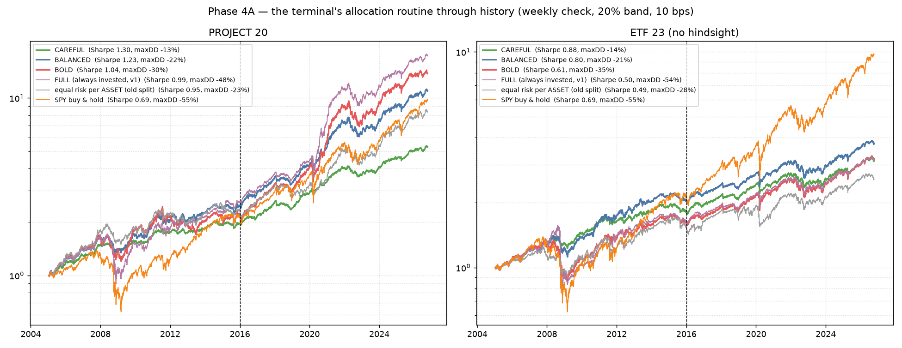

*Growth of $1 from 2005 to 2026 on a log scale (equal heights mean equal percentage moves), for the three risk profiles, two yardsticks and buy-and-hold S&P 500 in orange; the left panel is the project's 20 assets, the right the 23 hindsight-free ETFs, and the dashed vertical at 2016 is where the frozen parameters stop being fitted and start being tested.*

This is the framework running through history with weekly checks, a 20% drift band and 10 bps of costs on every trade. Read the left panel as a single journey.

- **2005 → October 2007: everything rises together, $1 → ~$1.6.** The pre-crisis expansion. All six lines are bunched; in a calm bull market, risk management looks like a waste of money. This is the stretch during which every investor concludes they don't need it.
- **October 2007 → March 2009 — the Global Financial Crisis.** The orange S&P line collapses from ~1.6 to ~0.72: a **−55% drawdown**, the deepest on the chart. The purple always-invested book falls nearly as far (−48%). The risk-capped profiles dip visibly less — and the green CAREFUL line is barely dented. What happened mechanically: as volatility exploded and correlations converged, the measured 1-in-20 bad month blew through each profile's cap, so the invested share was cut automatically, week after week. **No one forecast Lehman.** The arithmetic simply refused to keep carrying that much risk at those prices.
- **The real-world machinery of that stretch.** Subprime securitisation froze, Lehman Brothers failed in September 2008, interbank credit stopped, and the Fed cut to 0–0.25% by December. Oil, which had touched ~$145 in July 2008 on an inflation scare, fell **−72%** into year-end as industrial demand evaporated — the fastest switch from an inflation panic to a deflation panic in living memory. The asset that saved portfolios was long-maturity government debt: when the danger is depression, a fixed coupon becomes precious, and TLT returned **+25%** across the window while the S&P lost **−55%**.
- **March 2009 → 2013 — the recovery, and the most under-appreciated region on the chart.** The risk-sized books spend years *above* the orange line. Not because they earned more in the rebound, but because they lost less in the collapse. The arithmetic is brutal and non-negotiable: a −55% loss requires a **+122%** gain to get back to even, while a −22% loss needs only **+28%**. The S&P did not regain its 2007 peak until 2013. Capital that never fell that far never had to spend four years climbing back.
- **2016, the dashed line.** Everything to its right was produced by parameters chosen using only the data to its left, and never touched again.
- **February–March 2020 — the Covid crash, the sharp V-notch.** The S&P fell **−34% in 23 trading days**, the fastest collapse from an all-time high in history; WTI crude futures printed **−$37.63** on 20 April when physical storage filled; the VIX hit the low 80s. A sudden liquidity freeze is the hardest case for a volatility-based system, because the shock arrives faster than any estimator can update. The notch in the risk-capped lines is clearly visible — and clearly shallower. Then the Fed cut to zero and announced open-ended purchases, and the market turned in three weeks.
- **April 2020 → November 2021 — the steepest climb in the entire sample.** Stimulus, zero rates, crypto, meme equity. Note the log scale: this is a genuinely enormous move, and the risk framework participates fully, because in that period volatility was *low* and the caps were not binding. The system does not refuse to make money; it refuses to carry unmeasured risk.
- **January → October 2022 — the inflation shock.** Purple falls from ~13 to ~8.6, the S&P −24%, and the thing that makes this episode different from 2008: **long bonds crashed too, −31%**, because CPI hit 9.1% in June and the Fed raised 425 bp in a single year. The classic 60/40 portfolio had its worst year since the Great Depression. The only things that rose were oil, energy equities and broad commodities. This is the crisis that proves the segment design — if your "safe" sleeve is just duration, you had no hedge at all in 2022.
- **2023 → 2026 — the resumption**, ending roughly: always-invested ~$17, BOLD ~$15, BALANCED ~$11, S&P ~$10, equal-risk-per-asset ~$9, CAREFUL ~$5.5.

**Now read the legend honestly, because the dollar ranking is the least important thing here:**

| Profile | Sharpe | Worst fall |
|---|---|---|
| CAREFUL | 1.30 | −13% |
| BALANCED | 1.23 | −22% |
| BOLD | 1.04 | −30% |
| Always invested (yardstick) | 0.99 | −48% |
| Equal risk per asset, no segments | 0.95 | −23% |
| **S&P 500 buy & hold** | **0.69** | **−55%** |

CAREFUL finishes **last in dollars and first in return-per-unit-of-risk**. That is not a flaw, it is the contract: it was asked to keep a bad month near −3%, and it did, for twenty-one years including two of the worst crashes on record.

**And the right panel — the one that keeps me honest.** On the 23 hindsight-free ETFs, **the S&P ends highest in dollars** ($9 against BALANCED's ~$4.7), with Sharpe 0.69 against 0.80 and a −55% drawdown against −21%. Over 2016–2026 US large-cap equity was close to unbeatable in raw dollars, and any framework claiming otherwise on that period is selling something. What the framework delivers is not more money; it is **the same journey with a third of the cliff**, and a plan a real person can hold through 2008 without capitulating at the bottom.

---

### 13. The honesty test: the same strategy, on a universe chosen with no hindsight

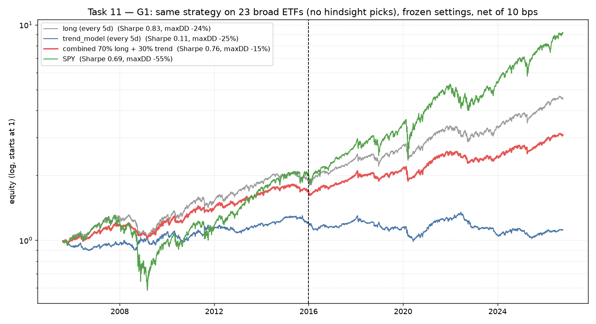

*The identical strategy, with every setting frozen, run on 23 broad ETFs that anyone could have bought in 2005: the risk-sized long book in grey, the trend model in blue, a 70/30 blend in red, and the S&P in green, all net of 10 bps.*

The 20-asset universe contains Nvidia, Bitcoin, Solana and MicroStrategy. I chose them in 2026, knowing how they turned out. That is **survivorship and hindsight bias**, and the only cure is to re-run everything on assets picked without it.

- **2005 → 2007: grey (the risk-sized book) runs above green (the S&P).** Diversified, risk-sized, boring. Blue trend goes nowhere.
- **September 2008 → March 2009 — the separation.** Green collapses to ~0.55 of its starting dollar. Grey dips to ~0.95. **Blue — the trend model — actually rises through the crisis to ~1.15.** This is the famous 2008 of managed futures: a trend follower short equities, short oil after July, long bonds into the collapse, had its best year ever precisely when everything else had its worst. The lesson is not "trend works"; it is that **trend's value is shaped like insurance** — a small premium paid in calm years, a payout in the crash.
- **2009 → 2015: grey compounds steadily; green recovers hard and crosses above grey around 2016–17; blue drifts up to ~1.3 and then flattens for a decade.**
- **February 2020: all three dip; blue does *not* save anyone this time** — the Covid crash was too fast for a 21-day trend signal, which was still positioned long when the floor opened.
- **2022: green falls, red (the blend) falls less.**
- **The end state, and the verdict in one line of legend:** S&P Sharpe 0.69 with a −55% worst fall; the risk-sized long book **Sharpe 0.83 with a −24% worst fall** (the outperformance is statistically real, t = 3.8); the blend red Sharpe 0.76 with the shallowest fall of all, **−15%**; and the trend model **Sharpe 0.11** — on a universe without hindsight picks, over twenty-one years, trend-following is indistinguishable from a flat line that charges you commissions.

**This graph is the reason the project ended where it did.** Attempt 3 found a trend edge worth Sharpe 0.41 — and attempt 4, this chart, showed that the edge lived entirely in the assets I had chosen with the benefit of hindsight. What survived the honest test was **not prediction**. It was **diversification plus volatility sizing**: the grey line.

---

### 14. The report card: do the warnings actually come true 1 time in 20?

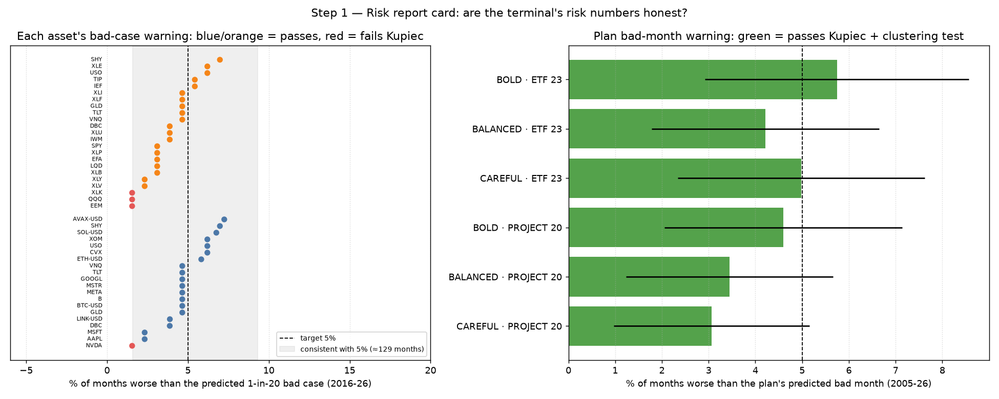

*Left: for each asset, the percentage of months whose real loss was worse than the 1-in-20 bad case the system had warned about beforehand, over the 2016–26 holdout — the dashed line is the 5% target, the grey band is the range that is statistically consistent with 5% given ~129 months, blue dots are the project universe, orange the ETFs, red means it failed the formal test. Right: the same check for the whole plan, per profile and universe, with its confidence interval.*

Anyone can print a risk number. The question that makes it a product rather than a decoration is whether the number has been **audited the way a bank audits its own**, and that is what this chart is: 4,348 project forecasts and 6,117 ETF forecasts, each made using only information available on the day, each checked against the month that actually followed.

- **The dense cluster between 3% and 7%, straddling the dashed line.** Most assets breached their bad-case warning at close to the promised rate. SPY, GLD, TLT, BTC, XLF, IWM, LQD — all land in the band. The warning means what it says.
- **The right-hand edge of the band — SHY ~7%, XLE ~6.6%, USO ~6.2%.** Breached slightly more often than promised, but still inside the range luck allows over 129 months.
- **The four red dots on the LEFT — XLK, QQQ, EEM (orange) and NVDA (blue), at 1.5–1.8%.** These are the formal failures, and the direction matters enormously: they breached **far less often than 5%**, which means their warnings were **too pessimistic**, not too optimistic. The system told holders of Nvidia that a terrible month would be worse than it turned out to be. A risk model should fail on the cautious side or not at all — and that is the only way this one failed.
- **The pooled numbers.** 4.72% of project asset-months and 3.91% of ETF asset-months breached, against a 5% target; **95% and 87% of assets individually passed the Kupiec test.**
- **The result that isn't visible but matters most: 100% of assets passed the Christoffersen independence test.** Breaches did not clump. The warnings were not merely "right on average while being wrong every time it mattered" — the bad months arrived scattered through history rather than all at once in one panic. A risk model that passes frequency but fails clustering is a model that works until the day you need it.
- **The right panel — the plan-level bad month, all six bars green.** CAREFUL, BALANCED and BOLD, on both universes, breached their stated bad-month caps 3.0% to 5.8% of the time against a 5% target, every confidence interval comfortably spanning the line, every profile passing both the frequency and the clustering test over 2005–2026.

**What failed, and what happened next.** The same report card **failed** the upside number (good months beat the "good case" 8–12% of the time rather than 5% — the upside was understated), the typical-range band (60–64% inside rather than 67%) and expected shortfall (real breach losses ran 7% worse than predicted on the project assets). A second, separately pre-registered fix — a universe-wide drift shift and a width factor, both fitted only on 2005–2015 and then frozen — brought the typical range to **64.9% / 65.5%** (pass) and the bad case to **5.93% / 5.70%** with 100% of project assets passing (pass). The good case and expected shortfall still failed.

**So they are not on the screen.** The terminal shows the bad case, the typical range and the plan's bad month, at the one-month horizon only, because that is the only horizon that has been through a report card. The week, three-month, six-month and one-year numbers are coded and hidden until they pass one. **An unverified number is not a feature; it is a liability with a nice font.**

---

## Why the *type* of crisis matters more than its size

Three crises, three completely different hedges — this is the empirical core of the segment design, and the reason "stocks down, buy bonds" is not a strategy but a bet on one specific kind of disaster.

Every number in this table is computed from the project's own cleaned price panel over the stated window, not quoted from memory.

| Episode (window) | What it actually was | S&P 500 | Long bonds (TLT) | Gold | Oil & energy | What saved you |
|---|---|---|---|---|---|---|
| **2008 GFC** (9 Oct 07 → 9 Mar 09) | credit freeze → deflation scare | **−55.2%** | **+25.1%** | +23.9% | USO −53.3%, VNQ −69.3% | sovereign bonds, gold |
| **2020 Covid** (19 Feb → 23 Mar 20) | sudden liquidity freeze | **−33.7%** in 23 sessions | **+14.2%** (+17.9% at its peak) | −3.6% | USO −56.4%, CVX −51.0% | sovereign bonds, then central banks |
| **2022 inflation** (calendar year) | 9.1% CPI, 425 bp of hikes, war | −18.2% (−24.5% peak-to-trough) | **−31.2%** | −0.8% | **XOM +87.4%, CVX +58.5%, USO +29.0%, DBC +19.3%** | energy equities, crude, commodities |

**2008 — the deflationary collapse.** Demand evaporated, prices fell, central banks cut toward zero. Fixed coupons became precious: long Treasuries returned **+25%** across the crash window — and **+32%** measured from oil's July 2008 peak into year-end, the stretch in which crude fell **−72%**. If you held stocks and long bonds, you were fine.

**2020 — the liquidity freeze.** For about two weeks in March, *everything* was sold, including gold and Treasuries, because margin calls do not care what you own. Then policy arrived — zero rates, open-ended purchases — and the flight-to-safety pattern reasserted itself. The lesson here is about speed: no estimator updates fast enough, which is why the defence has to be structural (how much you own) rather than reactive (what you sell on the day).

**2022 — the one that broke the textbook.** Inflation does to a long bond exactly what it does to a stock, because both are priced off the same discount rate. TLT fell **−31%** over the year (−37% peak-to-trough) in the same year the S&P fell −24.5% from its January high. A 60/40 portfolio had its worst year since the Great Depression. Gold, the supposed inflation hedge, finished **flat (−0.8%)** — it hedges *real rates*, and real rates were rising. The *only* winners were real assets: Exxon **+87%**, Chevron **+59%**, crude **+29%**, broad commodities **+19%**. An investor diversified across "stocks and bonds" discovered they owned one bet with two names on it.

**Which is why the allocation is built from behaviours, not labels:**

- **Bonds (TLT, SHY)** — protection against recessions and credit freezes.
- **Oil, energy and commodities (USO, XOM, CVX, DBC)** — protection against unexpected inflation and supply shocks.
- **Gold (GLD, B)** — protection against falling real rates, currency debasement and geopolitical flight.
- **Productive equities (big tech, SPY)** — the engine during disinflationary growth.
- **Crypto** — convex technological optionality, held in deliberately tiny risk slices, because the correlation chart shows it is one bet, not five.

Each segment is sized to carry a comparable share of the *risk*, not of the money — so that whichever kind of crisis arrives, something in the book is built to rise.

---

## The terminal

The research runs as a live Streamlit application in `terminal/`, sharing one engine with the backtests, so what is on screen is what was tested.

| Tab | What it does |
|---|---|
| **OVERVIEW** | live prices, per-segment risk cards with swing indicators, a 3D globe of geopolitical tension across 44 countries, macro warning gauges |
| **PLAN** | the allocation engine: risk budget per segment, a buy list, the weekly trade list with the 20% band, holdings log |
| **CALCULATOR** | what any invested amount means in dollars for a typical month and a 1-in-20 bad month, using the verified empirical ranges |
| **ASSET DETAIL** | per-asset 21-day return histogram, 12-month price history, rolling volatility regime |
| **WORLD** | VIX, yield-curve inversion, credit spreads, the Sahm rule, breakeven inflation, and the historical crisis playbook |
| **NEWS** | live financial RSS with themed tags (optional AI macro summary when an API key is set) |
| **ALERTS** | a 60-day auditable feed of factual events — volatility regime shifts, 3σ moves, trend reversals — each debounced by a 3-day confirmation |

```bash
pip install -r requirements.txt && streamlit run terminal/app.py
```

## Repository map

| Path | What's in it |
|---|---|
| `src/` | the library: cleaning, features, signals, trend model, volatility forecasts, portfolio simulator, S&P 500 point-in-time membership |
| `scripts/` | one numbered script per task, 01 (fetch) through 18 (risk recalibration) |
| `terminal/` | the live application: `risk.py` (swings and ranges), `allocate.py` (the allocation engine), `world.py`, `news.py`, `alerts.py` |
| `reports/figures`, `reports/tables` | every figure and every result table in this README |
| `Quant_Momentum/` | the research vault: methodology notes, per-task graph explanations, the task log, the prediction attempts log, the problem statement |
| `data/` | raw and cleaned price panels: the 2021+ universe, the 2004+ long history, the 23-ETF set, the S&P 500 panel |

## What this project does *not* claim

1. **The 20-asset universe was chosen with hindsight.** Nvidia, Bitcoin, Solana and MicroStrategy were picked in 2026, knowing the answer. Every conclusion that matters was therefore re-tested on 23 ETFs that required no hindsight — and where the two disagree, the ETF result is the one I believe.
2. **Only the one-month horizon is verified.** Week, quarter, half-year and year numbers exist in code and are hidden until each passes its own report card.
3. **Two risk numbers failed their audit** — the upside case and expected shortfall — and remain hidden rather than relabelled.
4. **No live forward record yet.** Everything here is a historical test, however carefully embargoed. A weekly paper-trading record, saved forward from today with no ability to revise it, is the next honest step.
5. **Costs are modelled at 10 bps per trade.** That is reasonable for liquid ETFs and optimistic for crypto in stress.
6. **Crypto did not exist for most of the long backtest** — Bitcoin from 2014, Solana from 2020 — so the 2008 segment of those curves is an equities, bonds, gold and oil book.
7. **Nothing here forecasts a price.** Six attempts, all documented with their failures, are in `Quant_Momentum/Product/Prediction Attempts Log.md`.

## Author

**Fahad Naseer** — quantitative research, volatility modelling, systematic allocation and the trading infrastructure around it.

- GitHub: [fahadnaseerhs](https://github.com/fahadnaseerhs) · Repository: [Quant-Momentum](https://github.com/fahadnaseerhs/Quant-Momentum)
- Email: [fahadnaser451@gmail.com](mailto:fahadnaser451@gmail.com)

## License

MIT — see [LICENSE](LICENSE).
