# Quant-Momentum: K-Nearest Neighbours and Gaussian Naive Bayes from Scratch

### Branch `knn-naive-bayes`: 22 Years of Technology Stocks (AAPL, MSFT, NVDA, GOOGL, META)

Repository: [https://github.com/fahadnaseerhs/Quant-Momentum/tree/knn-naive-bayes](https://github.com/fahadnaseerhs/Quant-Momentum/tree/knn-naive-bayes)  
Main Project (Multi-Asset Terminal and Research Diary): [https://github.com/fahadnaseerhs/Quant-Momentum](https://github.com/fahadnaseerhs/Quant-Momentum)

---

## Executive Summary: What Two Mathematical Classifiers Can and Cannot Predict

This branch isolates a foundational machine learning study built on 22 years of market closing prices across the five largest technology equities: Apple (AAPL), Microsoft (MSFT), Nvidia (NVDA), Alphabet (GOOGL), and Meta Platforms (META). 

Both K-Nearest Neighbours (K-NN) and Gaussian Naive Bayes (GNB) were implemented strictly from mathematical first principles using only NumPy, Pandas, and Matplotlib. No high-level machine learning libraries (such as scikit-learn) were used. The implementations were subjected to rigorous walk-forward out-of-sample evaluation, temporal embargo gaps to prevent lookahead leakage, naive baselines, and exact statistical significance testing.

### Key Empirical Findings

1. **Next-Day Price Direction (Up vs. Down): 50% Random Walk.**
   Neither K-NN (42.5% to 49.2%) nor Naive Bayes (46.1% to 53.4%) demonstrated any statistical edge over the trivial "always guess up" benchmark (50.3% to 53.4%). All p-values are p >= 0.50. Attempting to trade on next-day machine learning directional signals resulted in catastrophic portfolio drawdowns (-5% to -61%), while underlying buy-and-hold equity benchmarks gained +11% to +25%.

2. **Single-Day Volatility Magnitude: Unforecastable at 24-Hour Horizons.**
   Classifying whether tomorrow's absolute move |r(t+1)| would exceed its historical median yielded 54.9% (K-NN) and 52.8% (Naive Bayes), failing to beat the 54.6% majority baseline. Single-day moves are dominated by unscheduled news arrivals and microstructure noise.

3. **Next-Month Volatility Regime (High vs. Low Volatility): 66% to 68% Out-of-Sample Accuracy.**
   Across 843 out-of-sample stock-months from January 2012 to September 2026, both models significantly beat the majority baseline (54.7%) with p < 0.001. 
   - K-NN attained 66.3% accuracy and reduced continuous volatility level Mean Absolute Error (MAE) by 17% compared to naive persistence (9.2 vs 11.1 volatility points).
   - Gaussian Naive Bayes attained 68.1% directional regime accuracy, but suffered from severely overconfident posterior probabilities due to the violation of its feature independence assumption.
   - Most of this regime predictability stems from physical volatility clustering: a simple persistence heuristic ("next month equals this month") achieves 65.6%.

The empirical conclusion is unequivocal: **machine learning classifiers cannot reliably determine which direction asset prices will travel tomorrow. However, they can reliably quantify the volatility regime and turbulence of the coming month.**

---

## 1. Mathematical Formulation from First Principles

Both algorithms are constructed without external estimators or black-box abstractions.

### 1.1 K-Nearest Neighbours (K-NN)

K-NN operates directly on the geometric topology of historical market states.

1. **Feature Standardization:** Given a training feature matrix X_train of dimension N x d, each feature j is normalized using strictly in-sample parameters:
   
   z_j = (x_j - mu_j) / sigma_j
   
   where mu_j and sigma_j are the sample mean and standard deviation of feature j computed exclusively on the training window.

2. **Euclidean Distance Metric:** For any out-of-sample query vector z_query, the geometric distance to every stored historical observation z_i is calculated as:
   
   d(z_query, z_i) = sqrt( sum_{j=1}^d (z_{query,j} - z_{i,j})^2 )

3. **Neighbour Selection and Inference:**
   The indices of the K smallest distances are retrieved:
   
   Omega_K = argmin_{i, |Omega|=K} d(z_query, z_i)
   
   - **Continuous Regression Target (Expected Outcome):**
     y_hat = (1 / K) * sum_{i in Omega_K} y_i
     
     The dispersion among these K neighbours provides an empirical confidence interval around the forecast:
     s_hat = sqrt( (1 / (K - 1)) * sum_{i in Omega_K} (y_i - y_hat)^2 )

   - **Discrete Classification Target (Majority Voting):**
     P(C_k | z_query) = (1 / K) * sum_{i in Omega_K} I(y_i == C_k)

4. **Hyperparameter Selection:** K is tuned exclusively on separate historical validation periods (e.g., K = 200 for daily targets, K = 100 for monthly volatility regimes) and held constant during test evaluation.

### 1.2 Gaussian Naive Bayes (GNB)

Naive Bayes applies Bayes' Theorem under the conditional independence assumption:

P(C_k | x) = ( P(C_k) * prod_{j=1}^d P(x_j | C_k) ) / P(x)

1. **Prior Probability Estimation:**
   P(C_k) = N_k / N

2. **Conditional Likelihood Estimation:** Each feature given class C_k is assumed to follow a univariate Gaussian distribution:
   
   P(x_j | C_k) = (1 / sqrt(2 * pi * sigma_{k,j}^2)) * exp( - (x_j - mu_{k,j})^2 / (2 * sigma_{k,j}^2) )

   where mu_{k,j} and sigma_{k,j}^2 are the maximum likelihood mean and variance estimates for feature j within class C_k. A numerical variance floor (1e-9) is added to sigma_{k,j}^2 to guarantee stability.

3. **Log-Likelihood Transformation:** To eliminate numerical underflow from multiplying small floating-point probabilities across multiple dimensions, computations are executed in log-space:
   
   log P(C_k | x) = log P(C_k) + sum_{j=1}^d [ -0.5 * log(2 * pi * sigma_{k,j}^2) - ((x_j - mu_{k,j})^2 / (2 * sigma_{k,j}^2)) ]

4. **Posterior Normalization (Log-Sum-Exp):**
   Posterior probabilities are recovered via the numerically stable Log-Sum-Exp operator:
   
   P(C_k | x) = exp( log P(C_k | x) - log( sum_m exp(log P(C_m | x)) ) )

### 1.3 The Failure Mode of the "Naive" Independence Assumption

In quantitative finance, features such as 5-day, 21-day, 63-day, and 252-day historical volatility are strongly collinear (pairwise correlations typically exceed 0.70 to 0.90). 

When features correlate strongly, Gaussian Naive Bayes treats each collinear feature as independent, reinforcing evidence repeatedly. Consequently, posterior probabilities polarize toward 0.0 or 1.0. As proven in our calibration experiments, when Naive Bayes outputs a 95% confidence score, empirical accuracy is often only 70% to 75%.

---

## 2. Data Architecture and Leakage Prevention Protocol

| Parameter | Specification |
|---|---|
| Historical Scope | January 2, 2004 to October 9, 2026 (5,729 trading sessions) |
| Asset Universe | AAPL, MSFT, NVDA, GOOGL (from IPO August 2004), META (from IPO May 2012) |
| Primary Data Source | Daily adjusted close prices (`data/long/processed/prices_daily_clean.parquet`) |
| Calendar Alignment | Official NYSE trading calendar; non-trading days excluded |
| Gap Imputation | Forward-fill restricted to gaps <= 2 sessions; backward-filling strictly forbidden |
| Engineered Features | Past returns (1d, 5d, 21d, 63d), daily range magnitude, annualised volatility (5d, 21d, 63d, 252d) |

### Strict Anti-Leakage Protocol

1. **Chronological Splitting:** Shuffling time series data is completely prohibited. All training sets strictly precede test windows.
2. **Expanding Walk-Forward Retraining:** Models are retrained dynamically at the beginning of each evaluation cycle using only information historically available at that exact timestamp.
3. **The 21-Day Embargo Gap:** When predicting next-month (21-day) outcomes, a sample from day t cannot be admitted into the training set until day t + 21 has concluded and its outcome has materialized. Using overlapping windows without an embargo introduces severe target leakage.
4. **Isolated Scaling:** Mean and standard deviation scaling vectors are computed on the training fold and applied out-of-sample to the test fold.

---

## 3. Experiment 1: Next-Day Direction Classification (Up vs. Down)

- **Target:** Sign of next-day return: y(t+1) in {Up, Down}.
- **Out-of-Sample Test Window:** January 2026 to October 2026 (daily frequency).
- **Hyperparameter:** K = 200 (selected on 2025 validation set).
- **Driver Script:** `knn_nb/run.py`

### Directional Results Summary

| Stock | K-NN Accuracy | Naive Bayes Accuracy | Always Up Baseline | Binomial p-value (K-NN) |
|---|---|---|---|---|
| AAPL | 47.9% | 46.1% | 53.4% | 0.941 |
| MSFT | 42.5% | 48.2% | 50.8% | 0.993 |
| NVDA | 48.2% | 53.4% | 52.8% | 0.913 |
| GOOGL | 48.7% | 48.7% | 52.3% | 0.865 |
| META | 49.2% | 49.2% | 50.3% | 0.655 |
| **Pooled** | **47.3%** | **49.1%** | **51.9%** | **0.999** |

### Visual Artifacts: Experiment 1

#### K-NN Forecast vs. Actual Returns
The K-NN regression estimate clusters near zero because historical nearest neighbours possess divergent subsequent returns that cancel out.

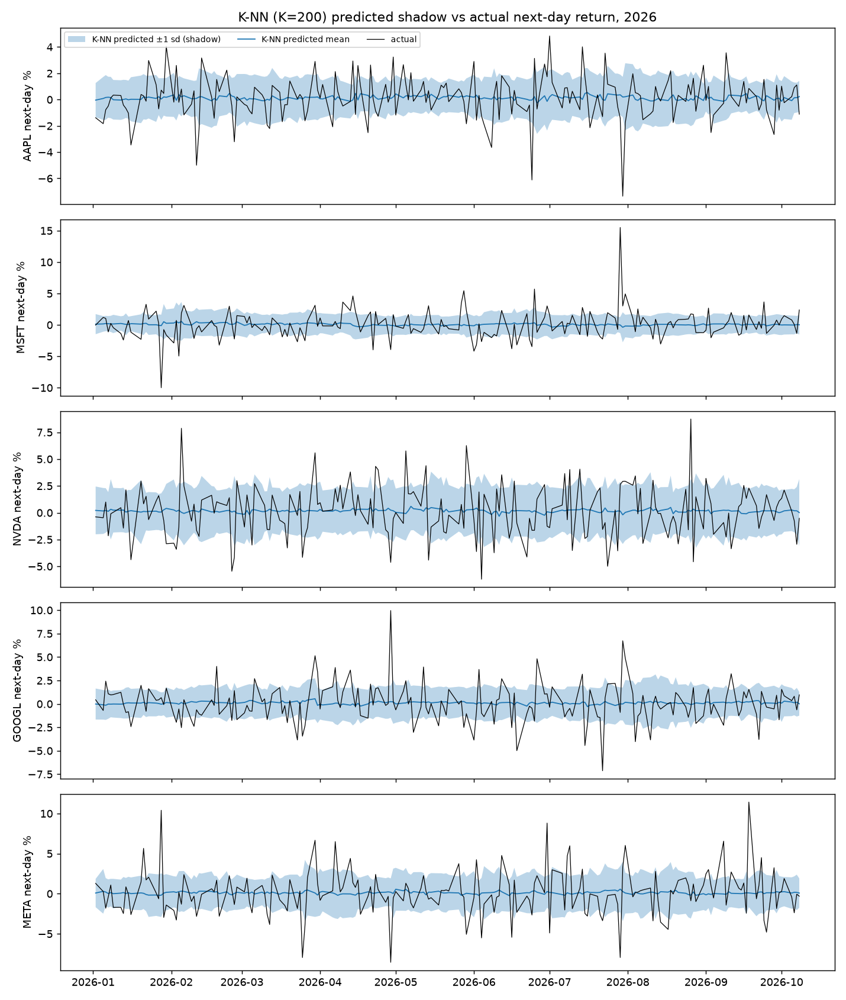

#### Naive Bayes Posterior Probability
Naive Bayes posterior probability P(Up) hovers tightly around 0.50 and exhibits zero correlation with true daily market direction.

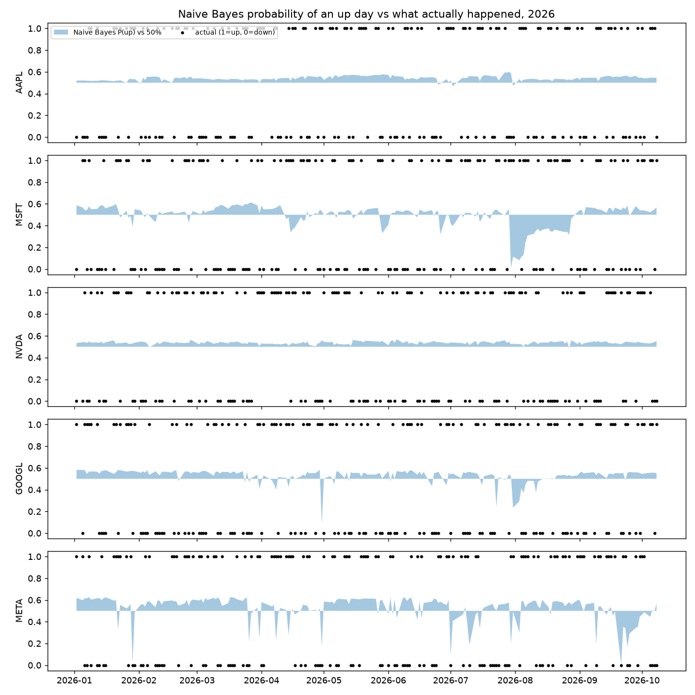

#### Capital Destruction: Trading Signal vs. Buy-and-Hold
Simulating a strategy that switches between long equity and cash based on daily model signals demonstrates significant capital loss. Frequent turnover, false signals, and whipsaw price action eroded portfolio equity by up to -61%, whereas static buy-and-hold generated positive returns of +11% to +25%.

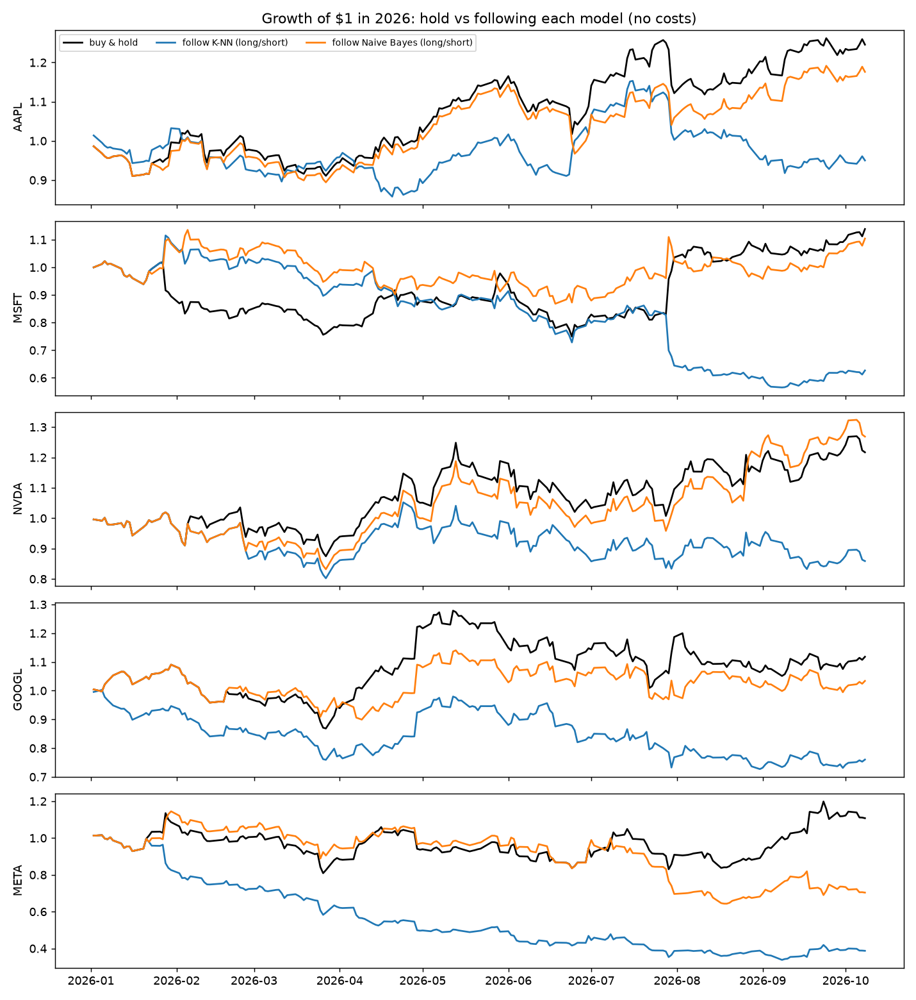

---

## 4. Experiment 2: Next-Day Volatility Magnitude

- **Target:** Is tomorrow's absolute return |r(t+1)| above the trailing median magnitude?
- **Out-of-Sample Window:** January 2026 to October 2026 (daily frequency).
- **Hyperparameter:** K = 400.
- **Driver Script:** `knn_nb/run_vol.py`

### Magnitude Results Summary

| Stock | Majority Baseline | K-NN Accuracy | Naive Bayes Accuracy |
|---|---|---|---|
| AAPL | 54.9% | 53.9% | 51.3% |
| MSFT | 54.4% | 55.4% | 52.3% |
| NVDA | 54.4% | 56.5% | 54.9% |
| GOOGL | 54.9% | 54.4% | 53.4% |
| META | 54.4% | 54.4% | 51.8% |
| **Pooled** | **54.6%** | **54.9%** | **52.8%** |

At daily frequencies, absolute price changes are dominated by unscheduled news arrivals. With no persistent autocorrelation across isolated 24-hour windows, models fail to beat baseline chance.

### Visual Artifacts: Experiment 2

#### Magnitude Shadow vs. Realized Move
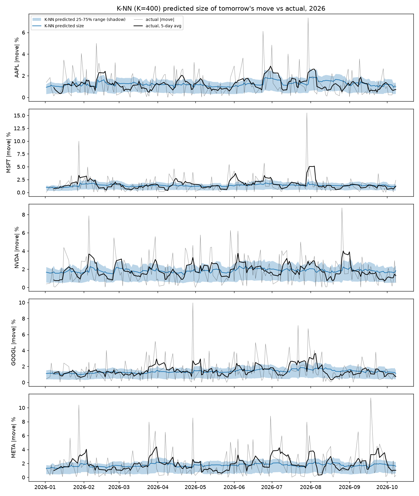

#### Magnitude Quintile Breakdown & Scorecard
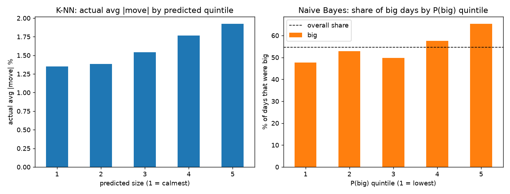
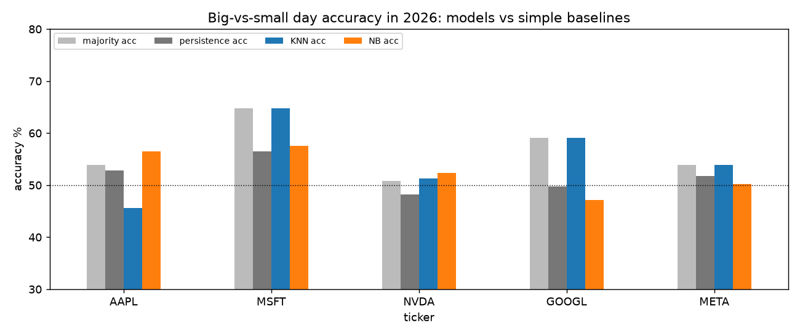

---

## 5. Experiment 3: Next-Month Volatility Regime (2012–2026)

- **Target:** Will realized volatility over the next 21 trading days exceed the stock's expanding historical median?
- **Evaluation Period:** January 2012 to September 2026 (843 total out-of-sample stock-months).
- **Hyperparameter:** K = 100 (calibrated on 2008–2011 crisis validation fold).
- **Driver Script:** `knn_nb/run_regime.py`

### Walk-Forward Architecture with 21-Day Embargo

The following schematic illustrates how each monthly prediction is generated: the historical training block expands forward, a mandatory 21-day embargo separates completed outcomes from the evaluation date, and the subsequent 21 days form the test target.

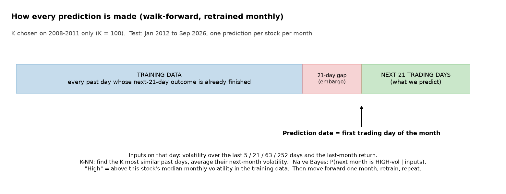

### Comprehensive Volatility Regime Scorecard (2012–2026)

| Stock | Sample Months | Always Majority Baseline | Persistence Baseline | K-NN Accuracy | Naive Bayes Accuracy | Binomial p-value vs Majority |
|---|---|---|---|---|---|---|
| AAPL | 177 | 67.8% | 69.5% | 68.9% | **73.4%** | p = 0.052 |
| MSFT | 177 | 50.8% | 58.2% | 61.0% | **63.3%** | p < 0.001 |
| NVDA | 177 | 58.2% | 69.5% | 69.5% | **70.6%** | p < 0.001 |
| GOOGL | 177 | 50.8% | 66.7% | 63.8% | **68.4%** | p < 0.001 |
| META | 135 | 54.8% | 63.7% | **68.9%** | 63.7% | p = 0.003 |
| **All Pooled** | **843** | **54.7%** | **65.6%** | **66.3%** | **68.1%** | **p < 0.001** |
| 2026 Only | 45 | 64.4% | 60.0% | **66.7%** | 55.6% | p = 0.450 |

### Key Analytical Takeaways

1. **Both Models Reject the Random Null Hypothesis (p < 0.001):** Across 843 out-of-sample test months, market volatility exhibits profound memory.
2. **The Persistence Benchmark is Formidable (65.6%):** Setting next month's regime equal to the current trailing regime achieves 65.6% accuracy. This confirms that the predictive engine of both algorithms is primarily learning volatility clustering (Mandelbrot, 1963; Engle, 1982).
3. **K-NN Solves Continuous Volatility Levels:** While classification accuracy between K-NN and Persistence is comparable (66.3% vs 65.6%), K-NN provides a 17% reduction in Mean Absolute Error on continuous annualized volatility forecasts (9.2 percentage points vs. 11.1 for persistence).
4. **Why Accuracy Caps at ~70%:** Exogenous geopolitical and macro shocks (e.g., COVID-19 in February 2020, SVB collapse in March 2023) transition regimes without historical price precedent. The first month of an unforeseen crisis cannot be detected in advance by retrospective price data.

### Visual Artifacts: Experiment 3

#### Monthly K-NN Predicted Volatility (Shadow) vs. Actual (2012–2026)
Across 14 continuous years and five equities, K-NN tracks every major market cycle, including the 2015–2016 tech correction, the 2018 volatility spike, the 2020 liquidity shock, and the 2022 Federal Reserve tightening regime.

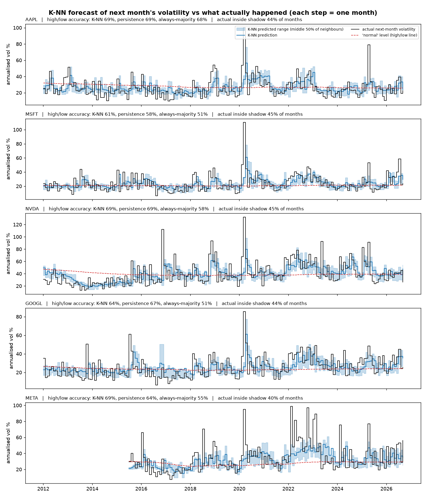

#### Naive Bayes Posterior Probability Trajectory
Naive Bayes successfully signals elevated crash risk during volatile clusters (indicated by red markers), but exhibits probability polarization.

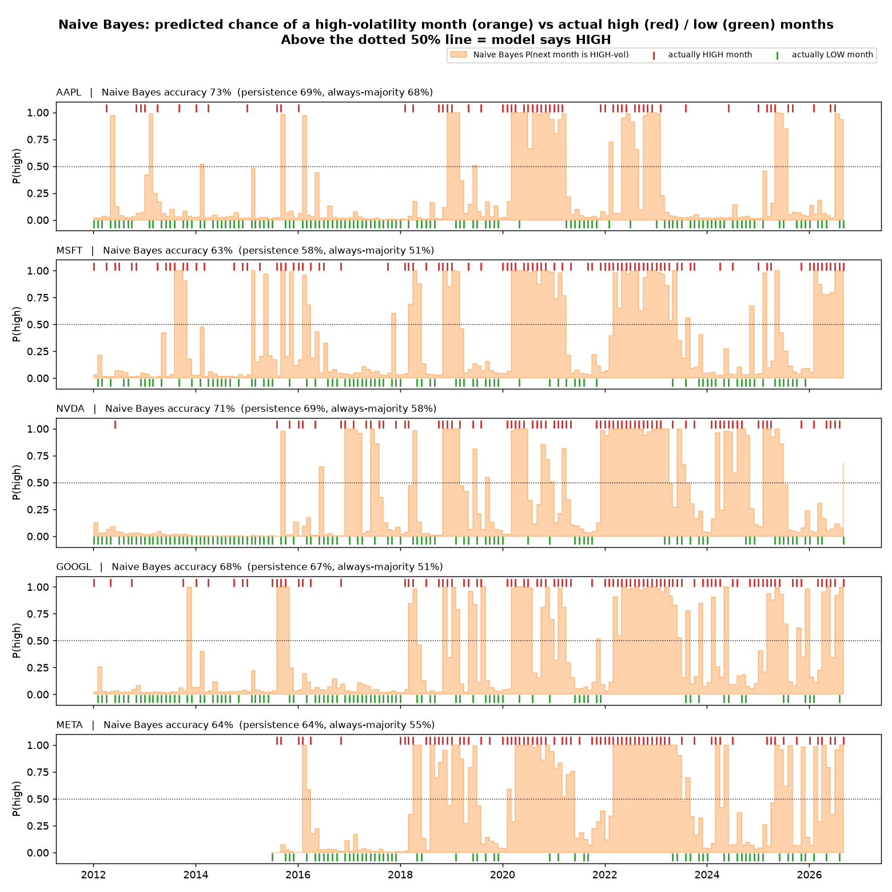

#### Full Regime Scorecard Across All Assets
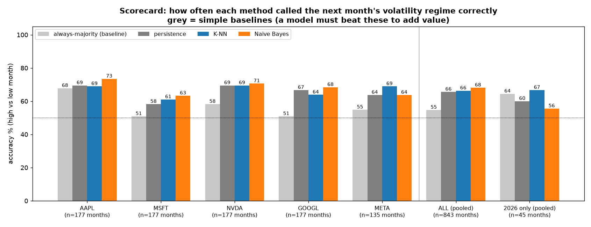

#### Reliability and Calibration Verification
- **Left Panel (K-NN Reliability):** Sorting K-NN forecasts into deciles creates a smooth, monotonic staircase of realized risk. The lowest predicted bucket experiences ~18% annualized volatility; the highest experiences ~48%.
- **Right Panel (Naive Bayes Calibration):** The calibration curve deviates substantially from the 45-degree diagonal, illustrating the probability inflation induced by collinear features.

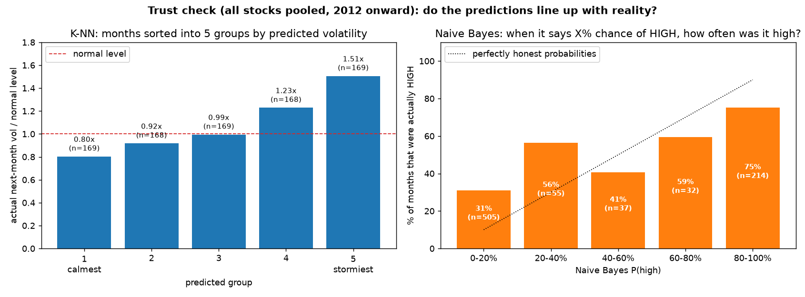

---

## 6. Directory Structure and Execution Instructions

```
knn_nb/
├── knn.py                        K-Nearest Neighbours from scratch (regression & classification)
├── naive_bayes.py                Gaussian Naive Bayes from scratch (log-space, variance floor)
├── run.py                        Experiment 1: Next-day direction (generates results.csv, g1-g3)
├── run_vol.py                    Experiment 2: Next-day magnitude (generates results_vol.csv, g4-g6)
├── run_regime.py                 Experiment 3: Next-month volatility regime (generates results_regime.csv, g7-g11)
├── results.csv                   Tabulated results for Experiment 1
├── results_vol.csv               Tabulated results for Experiment 2
├── results_regime.csv            Tabulated results for Experiment 3
├── figures/                      All 11 generated high-resolution analytical figures
└── report/
    ├── template.docx             Formal academic assignment template
    ├── build_report.py           Automated report generator inserting tables and graphs into Word
    └── KNN_NaiveBayes_Report.docx Formatted academic research deliverable
```

### Reproducing All Experiments Locally

To execute the full experimental pipeline from scratch:

```powershell
# 1. Run next-day direction experiment
python knn_nb/run.py

# 2. Run next-day magnitude experiment
python knn_nb/run_vol.py

# 3. Run next-month volatility regime experiment
python knn_nb/run_regime.py

# 4. Generate the formatted Word deliverable
python knn_nb/report/build_report.py
```

---

## 7. Author Bio and Academic Background

**Fahad Naseer**  
National University of Computer and Emerging Sciences (FAST NUCES)  
Department of Computer Science  
Focus: Quantitative Finance, Statistical Arbitrage, Mathematical Risk Systems, and Empirical Asset Pricing  
GitHub Profile: [https://github.com/fahadnaseerhs](https://github.com/fahadnaseerhs)  
Project Repository: [https://github.com/fahadnaseerhs/Quant-Momentum](https://github.com/fahadnaseerhs/Quant-Momentum)

---

## 8. License

This research branch and all accompanying source code are released under the MIT License. See [LICENSE](LICENSE) for full legal terms.
