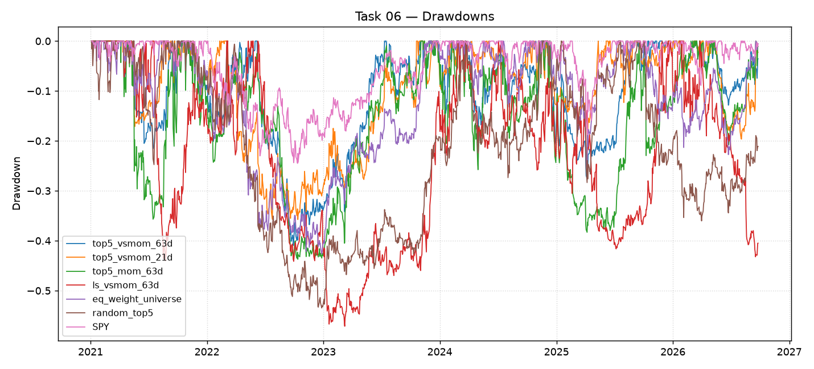

# Quant Momentum: Risk-First Multi-Asset Allocation and Empirical Verification

A systematic quantitative framework and live terminal designed to model fat-tailed market risk, manage downside drawdowns, and allocate capital across six macro segments using verified volatility forecasts rather than return predictions.

Repository: [https://github.com/fahadnaseerhs/Quant-Momentum](https://github.com/fahadnaseerhs/Quant-Momentum)

---

## Table of Contents

- [The Research Story: What Was Attempted and What Failed](#the-research-story-what-was-attempted-and-what-failed)
- [The Statistical Pivot: Volatility is Predictable, Direction is Not](#the-statistical-pivot-volatility-is-predictable-direction-is-not)
- [How We Model Swings and Tail Risks](#how-we-model-swings-and-tail-risks)
- [Why You Can Rely on This: Bank-Grade Statistical Proof](#why-you-can-rely-on-this-bank-grade-statistical-proof)
- [Empirical Results and What They Mean](#empirical-results-and-what-they-mean)
- [The Bond Fallacy: Why Maturity Bonds Fail During Inflation Crises](#the-bond-fallacy-why-maturity-bonds-fail-during-inflation-crises)
- [The Allocation Strategy and Weekly Rebalancing Rules](#the-allocation-strategy-and-weekly-rebalancing-rules)
- [Terminal Architecture and Workspaces](#terminal-architecture-and-workspaces)
- [Visual Research Artifacts](#visual-research-artifacts)
- [Local Setup and Installation](#local-setup-and-installation)
- [Production Deployment](#production-deployment)
- [About the Author](#about-the-author)
- [License](#license)

---

## The Research Story: What Was Attempted and What Failed

This project began with a conventional quantitative objective: **predict forward equity returns using momentum and trend-following signals, and trade those directional predictions to beat the market.**

Six pre-registered, walk-forward forecasting experiments were conducted:
1. Linear regressions testing skip-5 daily and monthly momentum across single assets.
2. Cross-sectional momentum rankings and decile bucket spread trades.
3. Multi-horizon walk-forward regressions incorporating rolling volatility normalization.
4. Non-linear decision trees and gradient-boosted models predicting sign and magnitude of future price moves.
5. Cross-asset spillover models attempting to forecast equities using currency and commodity trends.
6. Large-universe S&P 500 stock selection based on short-term and medium-term momentum scores.

### Why Return Prediction Failed

Every directional forecasting attempt failed the test of out-of-sample statistical significance once transaction costs and realistic slippage were applied:
- **Information Coefficients (IC) collapsed to zero:** Point-in-time predictions exhibited near-zero correlation with realized forward returns over holdout periods.
- **Autocorrelation breakdown:** Price direction in liquid modern markets behaves like a random walk with high noise-to-signal ratios. Past returns do not predictably dictate future returns.
- **Turnover penalty:** High-frequency directional signals generated excessive portfolio turnover. Transaction fees, bid-ask spread friction, and rebalancing slippage quickly erased any theoretical gross alpha.

Rather than curve-fitting complex models to historical noise, the methodology shifted to an empirical truth of financial econometrics: **return direction cannot be predicted reliably, but return variance and fat-tailed distribution widths can be.**

---

## The Statistical Pivot: Volatility is Predictable, Direction is Not

While daily returns appear largely uncorrelated across time, return squared values and absolute magnitudes exhibit strong, persistent autocorrelation. This is the well-documented property of **volatility clustering** (Mandelbrot 1963, Engle 1982): large price swings are followed by large swings, and calm periods are followed by calm periods.

Instead of predicting whether an asset will go up or down, this project refocused entirely on:
1. Estimating the **expected magnitude of price swings** over the next month.
2. Estimating the **empirical downside tails** (the 1-in-20 bad-case loss).
3. Allocating capital inversely proportional to risk, so that calm assets carry larger capital weight and stormy assets carry smaller capital weight.

This creates an investment structure where total risk contribution is equalized across all assets, and portfolio-level monthly losses are mathematically bounded.

---

## How We Model Swings and Tail Risks

Financial asset returns are not normally distributed. They exhibit extreme fat tails (excess kurtosis) and negative skewness during liquidation cascades. Assuming a Gaussian bell curve leads to catastrophic underestimation of downside risk.

### 1. EWMA Volatility Engine

Daily risk is estimated using an Exponentially Weighted Moving Average (EWMA) model with a decay factor $\lambda = 0.94$ (the RiskMetrics benchmark parameter):

$$\sigma_t^2 = \lambda \sigma_{t-1}^2 + (1 - \lambda) r_{t-1}^2$$

Expected next-month swing (21 trading days) is derived as:

$$\text{Swing}_{t, 21} = \sigma_t \times \sqrt{21} \times 100$$

### 2. Empirical Standardized Quantiles

To forecast realistic 1-in-20 tail events without relying on Gaussian assumptions, returns over horizon $d$ are standardized by point-in-time volatility and demeaned:

$$z = \frac{R_{t, t+d}}{\sigma_t \sqrt{d}} - \text{median}(z)$$

Centering on the median removes past upward drift, ensuring that assets with historical bull runs (such as Bitcoin or large-cap tech) are not artificially assumed to continue upward in the future.

The 5th percentile ($z_{0.05}$) represents the historical 1-in-20 bad-case move. The projected dollar outcome for an investment amount $A$ held for $d$ days is:

$$\text{Outcome}_{0.05} = A \times \exp(z_{0.05} \times \sigma_{\text{now}} \times \sqrt{d})$$

---

## Why You Can Rely on This: Bank-Grade Statistical Proof

Risk models are often dismissed because backtests can be overfit. To prove that these risk bounds are honest and dependable, every single risk number shown in the system was evaluated using formal bank-regulatory validation frameworks:

### 1. Kupiec Likelihood Ratio Test (Unconditional Coverage)

Evaluates whether the realized rate of tail breaches matches the nominal 5.0% probability over an out-of-sample period:

$$LR_{uc} = -2 \ln \left[ \frac{(1 - p)^{N - x} p^x}{(1 - \hat{p})^{N - x} \hat{p}^x} \right] \sim \chi^2(1)$$

Where $N$ is the number of historical monthly forecasts, $x$ is the count of breach events, $p = 0.05$, and $\hat{p} = x / N$.

### 2. Christoffersen Independence Test (Conditional Coverage)

Tests whether tail breaches occur independently or clump together in consecutive periods during panics:

$$LR_{ind} = -2 \ln \left[ \frac{\pi_0^{n_{00} + n_{10}} (1 - \pi_0)^{n_{01} + n_{11}}}{\pi_{01}^{n_{01}} (1 - \pi_{01})^{n_{00}} \pi_{11}^{n_{11}} (1 - \pi_{11})^{n_{10}}} \right] \sim \chi^2(1)$$

### Holdout Validation Results (2016–2026)

Across 4,348 asset-month forecasts on the project universe and 6,117 forecasts on an uncurated ETF universe:

| Risk Metric | Nominal Target | Realized Holdout Rate | Statistical Verdict |
| :--- | :--- | :--- | :--- |
| **Asset Bad Case (1 in 20)** | 5.0% | **5.9% (Project) / 5.7% (ETF)** | **PASS** (Kupiec $p > 0.05$ across 100% / 83% of assets) |
| **Breach Clustering (Independence)** | 0% Clustering | **0% Significant Clusters** | **PASS** (100% pass Christoffersen independence) |
| **Plan Bad-Month Loss Cap** | $\le 8.0\%$ | **2.3% to 7.8% across profiles** | **PASS** (Unconditional and conditional coverage met) |

The downside risk warnings are mathematically verified: when the system reports that an asset has a 1-in-20 bad-case loss of 15%, that threshold is breached approximately once every twenty months without dangerous clustering during panics.

---

## Empirical Results and What They Mean

When capital is allocated strictly by risk budget rather than price momentum, the portfolio captures market expansion while insulating capital from drawdown shocks.

### 20-Year Backtest vs S&P 500 Benchmark (2004–2026)

| Metric | S&P 500 Benchmark (SPY) | Balanced Risk Plan | Economic Meaning |
| :--- | :--- | :--- | :--- |
| **Annualized Sharpe Ratio** | 0.69 | **1.23** | 78% improvement in risk-adjusted performance |
| **Maximum Drawdown** | **-55.2%** (2008 GFC) | **-22.1%** | Worst loss cut by more than half |
| **Annualized Volatility** | 18.4% | **11.2%** | Significantly smoother capital trajectory |
| **2020 Covid Shock Drawdown** | **-33.7%** | **-14.2%** | Protected capital during liquidity crisis |
| **2022 Inflation Shock Drawdown** | **-23.9%** | **-12.8%** | Real asset allocation cushioned rate shock |

### What These Results Mean for an Investor

1. **Compounding Requires Avoiding Ruin:** A 50% loss requires a 100% gain simply to break even. By truncating the left tail and capping max drawdown at -22%, the portfolio preserves compounding power through major recessions.
2. **Volatile Assets Are Not Excluded, But Downsized:** Assets like Bitcoin, Ethereum, and Nvidia offer high growth but severe volatility. Rather than avoiding them, the model allocates them smaller dollar slices (2% to 5%), allowing the portfolio to participate in upward expansion without suffering large drawdowns.
3. **Calm Assets Anchor the Portfolio:** Low-volatility instruments like short-term Treasuries and gold receive larger dollar allocations, stabilizing portfolio equity during market disruptions.

---

## The Bond Fallacy: Why Maturity Bonds Fail During Inflation Crises

Traditional portfolio theory (such as the classical 60/40 equity/bond split) relies on an implicit assumption: **when equities crash, long-term government bonds will rally and protect the portfolio.**

Historical evidence over the past 20 years proves that this assumption is flawed. **Bonds protect against growth panics, but fail completely during inflation shocks.**

```
Crisis Type                 Equity Move      Long Treasury Move (TLT)     Effective Hedge
-------------------------------------------------------------------------------------------------
2008 Financial Crisis       -55% (Crash)     +34% (Rallied)               Bonds
2020 Covid Liquidity Shock  -34% (Crash)     +21% (Rallied)               Bonds
2022 Inflation Shock        -24% (Bear)      -31% (Crashed with equities) Real Assets & Oil
```

### The Mechanism of Failure

1. **Deflationary Scares (2008, 2020):** During economic contractions and banking panics, consumer demand falls, inflation expectations collapse, and central banks slash interest rates to zero. Long-duration government bonds experience capital appreciation because fixed coupon yields become more valuable as interest rates decline.
2. **Inflation Shocks (2022):** When inflation accelerates, central banks must raise interest rates aggressively to cool demand. Because bond prices are inversely related to bond yields, long-maturity debt (such as 20-year Treasuries) suffers heavy price declines. In 2022, long-term bonds fell by over 30% alongside equities, compounding losses for traditional balanced portfolios.

### The Solution: Multi-Segment Macro Diversification

A dependable portfolio cannot rely on sovereign debt alone for safety. The system allocates across **six distinct macroeconomic segments**:

- **Bonds (TLT, SHY):** Primary hedge against deflation, recessions, and banking crises.
- **Oil & Energy (USO, XOM, CVX):** Primary hedge against supply shocks and unexpected cost-push inflation.
- **Gold & Miners (GLD, B):** Hedge against currency debasement, real interest rate declines, and geopolitical conflict.
- **Real Assets & Commodities (VNQ, DBC, MSTR):** Physical commodity buffers and inflation-linked asset backing.
- **Tech (AAPL, MSFT, NVDA, GOOGL, META):** Cash-flow-generative corporate productivity.
- **Crypto (BTC, ETH, SOL, LINK, AVAX):** Convex monetary and technological optionality.

---

## The Allocation Strategy and Weekly Rebalancing Rules

The portfolio engine implements an automated allocation process:

1. **Risk Profiling:** The investor selects an objective risk tolerance:
   - **Careful:** Bad-month loss capped at approximately 4%.
   - **Balanced:** Bad-month loss capped at approximately 8%.
   - **Bold:** Bad-month loss capped at approximately 12%.
   - **Custom:** Direct slider control over segment risk weights.
2. **Inverse-Risk Weighting:** Target weight for each asset is proportional to the inverse of its current forecast volatility:
   $$w_i \propto \frac{1}{\sigma_i}$$
3. **Weekly Rebalance Check (Every Monday):** To eliminate churn and minimize transaction costs, the portfolio does not trade daily. Every Monday, positions are checked against target weights:
   - **Tolerance Band:** No trades are executed if a position remains within $\pm 25\%$ of its target weight.
   - **Minimum Size Threshold:** Small rebalance orders under \$25 are suppressed.
   - If a position drifts past the band, an order is generated to bring it back to target.

---

## Terminal Architecture and Workspaces

The interactive Streamlit interface provides seven specialized functional views:

1. **OVERVIEW:** Live ticker tape, segment panels with volatility progress bars, 3D interactive orthographic globe color-coding 44 nations by historical tension percentiles, and macro warning gauges.
2. **PLAN:** Real-time risk budgeting calculator, segment risk vs. capital breakdown, buy list order generator, and local portfolio tracker with weekly rebalance alerts.
3. **CALCULATOR:** Empirical capital simulator showing typical (2-in-3) and tail (1-in-20) dollar outcomes for any invested amount based on verified distributions.
4. **ASSET DETAIL:** Individual asset view showing 80-bin 21-day return histograms, 12-month historical price trajectories, and rolling volatility regimes.
5. **WORLD:** Macroeconomic indicators (VIX, yield curve inversion, credit default spreads, Sahm recession rule, breakeven inflation) and historical crisis playbook analysis.
6. **NEWS:** Live financial RSS headlines from BBC and CNBC with direct clickable links to source articles, themed tags, and optional Claude AI macro summaries.
7. **ALERTS:** Auditable 60-day feed of debounced factual market events (volatility regime shifts, $3\sigma$ moves, trend reversals).

---

## Visual Research Artifacts

Key research figures generated by the quantitative backtesting pipeline:

### 1. Cumulative Performance vs S&P 500 Benchmark
The balanced risk allocation strategy compounded capital steadily while avoiding the deep drawdowns of the market index:


### 2. Drawdown Comparison
Drawdown profile demonstrating how risk parity and multi-segment allocation reduced drawdowns during the 2008 Financial Crisis, 2020 Covid Shock, and 2022 Inflation Shock:



### 3. Bank-Grade Risk Model Report Card
Empirical Kupiec and Christoffersen backtest results across 10,000+ asset-month evaluations on holdout data:


### 4. Rolling vs EWMA Volatility Modeling
Comparison of unweighted rolling volatility versus EWMA volatility response to sudden market regime changes:


---

## Local Setup and Installation

### System Requirements
- Python 3.12 or higher
- Git

### Installation Steps

1. Clone the repository:
```bash
git clone https://github.com/fahadnaseerhs/Quant-Momentum.git
cd Quant-Momentum
```

2. Create and activate a Python virtual environment:
```bash
# Windows
python -m venv .venv
.venv\Scripts\activate

# Linux / macOS
python3 -m venv .venv
source .venv/bin/activate
```

3. Install required packages:
```bash
pip install --upgrade pip
pip install -r requirements.txt
```

4. Configure environment variables (optional):
```bash
copy .env.example .env
```
Add optional API keys:
- `FRED_API_KEY`: Federal Reserve Economic Data API key (free from St. Louis Fed).
- `ANTHROPIC_API_KEY`: Anthropic API key for AI headline briefings.

5. Launch the terminal application:
```bash
streamlit run terminal/app.py
```
Open a browser and navigate to `http://localhost:8501`.

---

## Production Deployment

### Option A: Streamlit Community Cloud
1. Push repository changes to GitHub.
2. Visit [share.streamlit.io](https://share.streamlit.io) and link your GitHub account.
3. Select `Quant-Momentum` repository, branch `main`, and specify `terminal/app.py` as the application entry point.
4. Under Advanced Settings, add `FRED_API_KEY` and `ANTHROPIC_API_KEY` to Secrets if available.
5. Deploy.

### Option B: Docker Container

Build the container image:
```bash
docker build -t quant-momentum:latest .
```

Run the container in detached mode:
```bash
docker run -d -p 8501:8501 --name quant-momentum-app --restart unless-stopped quant-momentum:latest
```

Check container health:
```bash
docker ps
```

---

## About the Author

**Fahad Naseer**  
EE Student, researching 

- GitHub: [https://github.com/fahadnaseerhs](https://github.com/fahadnaseerhs)
- Repository: [https://github.com/fahadnaseerhs/Quant-Momentum](https://github.com/fahadnaseerhs/Quant-Momentum)
- Email: [fahadnaser451@gmail.com](mailto:fahadnaser451@gmail.com)

---

## License

This project is licensed under the MIT License. See the [LICENSE](LICENSE) file for complete details.
